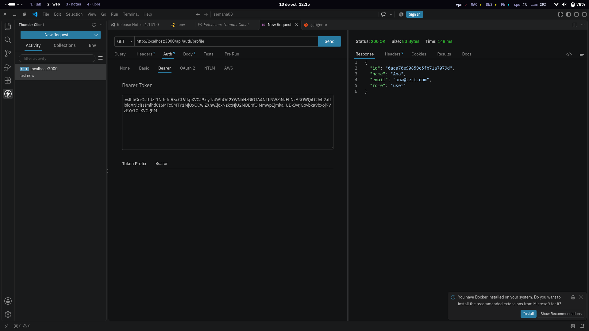
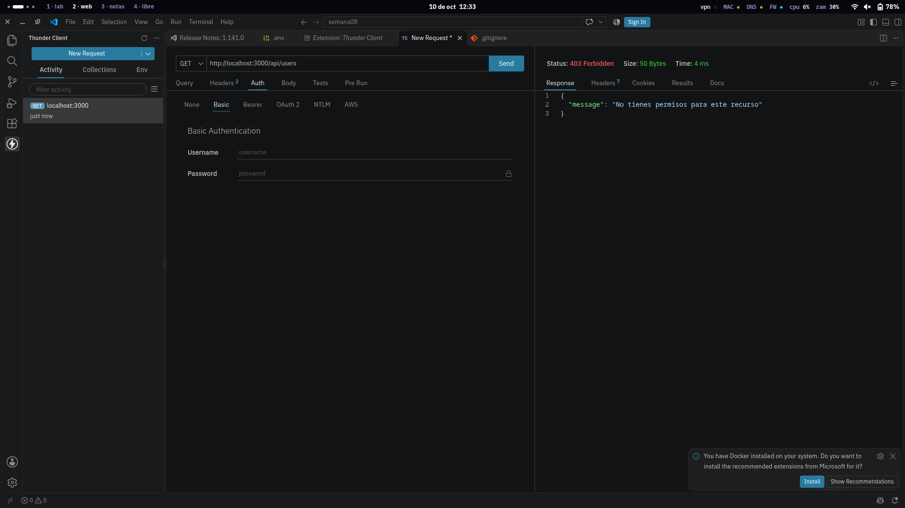
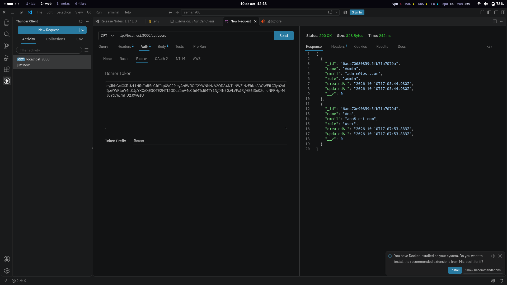

## Evidencias

Pruebas con **Thunder Client** (VS Code) contra la API en local, conectada a MongoDB Atlas.

### Autenticación
| Prueba | Resultado esperado | Captura |
|---|---|---|
| Registro de admin | 201 + token |  |
| Registro de usuario | 201 |  |
| Login de usuario | 200 + token |  |

### Rutas protegidas y roles
| Prueba | Resultado esperado | Captura |
|---|---|---|
| `GET /api/auth/profile` sin token | 401 |  |
| `GET /api/auth/profile` con token | 200 |  |
| `GET /api/users` con token de usuario | 403 |  |
| `GET /api/users` con token de admin | 200 |  |

### Base de datos en la nube
_pendiente: captura de la colección `users` en MongoDB Atlas_

### Despliegue (Render + GitHub Actions)
- API en la nube: _pendiente_
- Pipeline en verde: _pendiente_