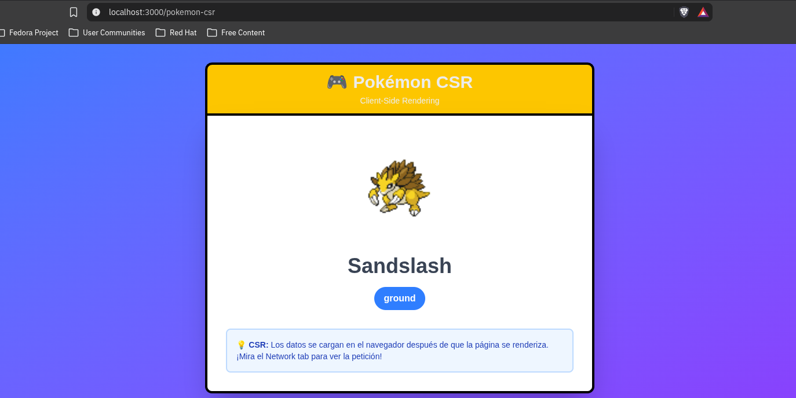
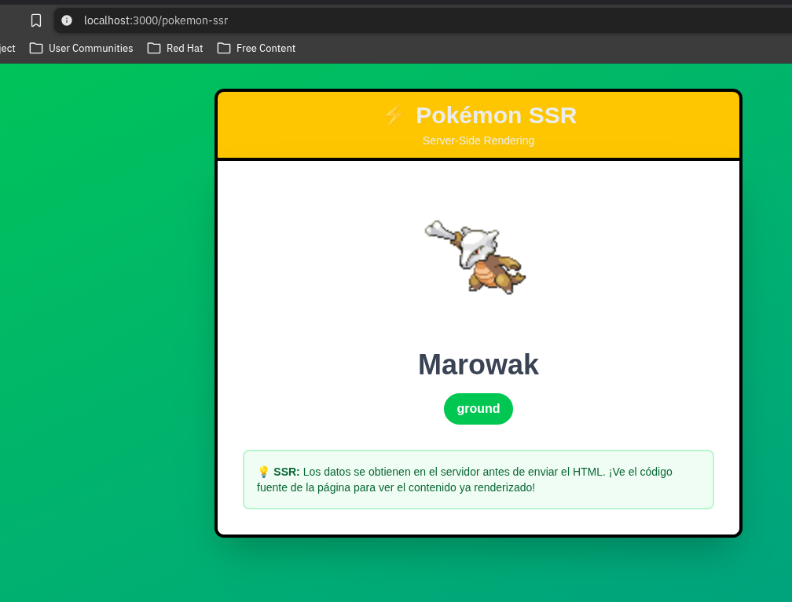
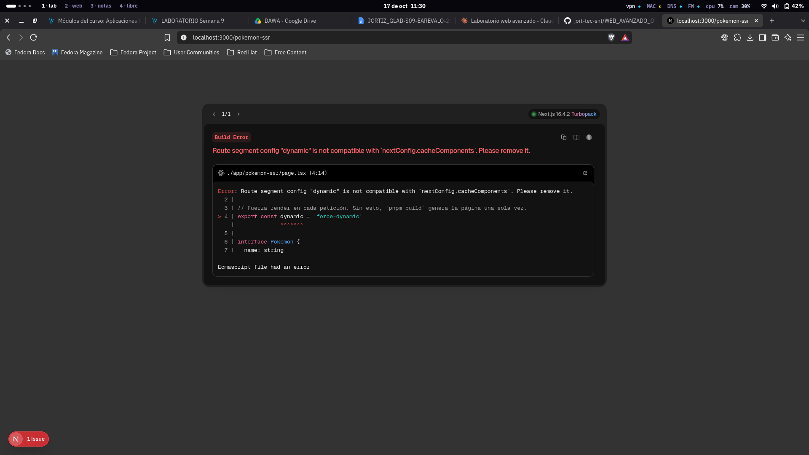
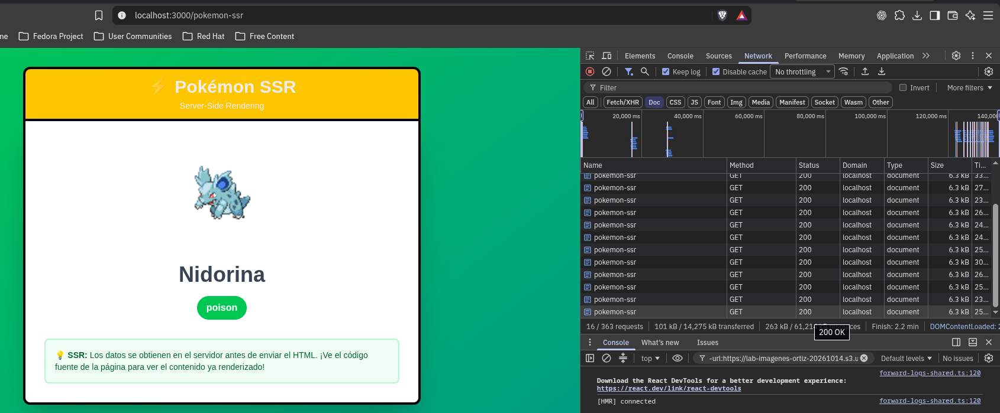
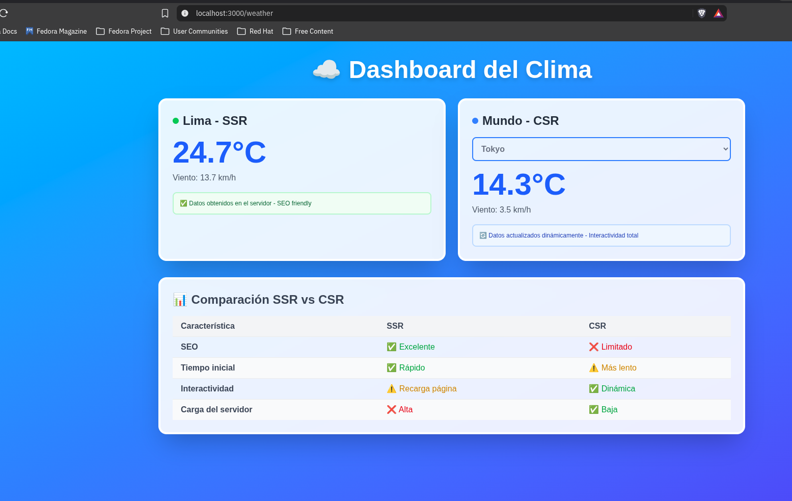
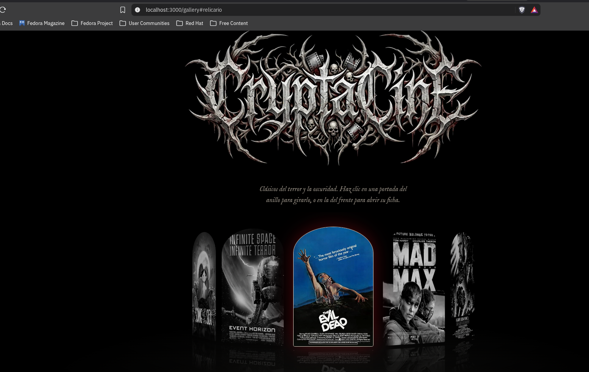
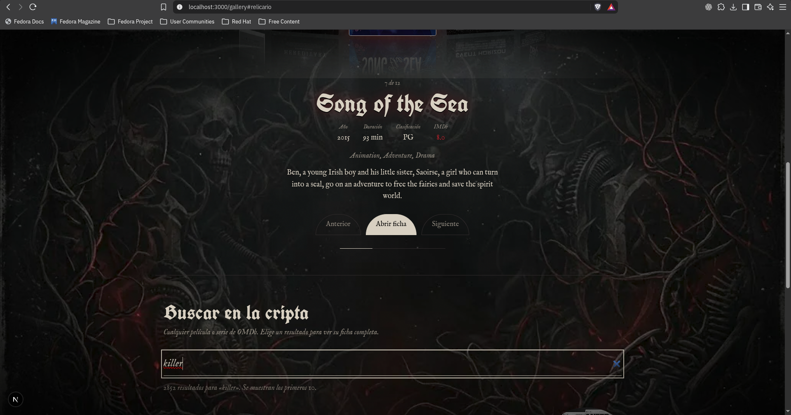
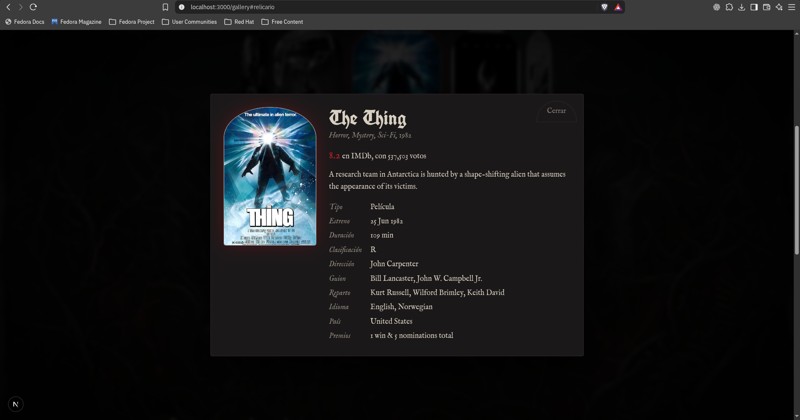

# Semana 09: Introducción a Next.js (CSR vs SSR)

Laboratorio 09 de Desarrollo de Aplicaciones Web Avanzado (DAWA), Tecsup. El proyecto está en [`next-pokeapp/`](next-pokeapp/).

## Qué se desarrolló

| Parte | Ruta | Qué hace |
|---|---|---|
| Ejercicio 1.1 | `/pokemon-csr` y `/pokemon-ssr` | Dos páginas idénticas con un Pokémon al azar: una renderizada en el navegador (CSR) y otra en el servidor (SSR) |
| Ejercicio 2.1 | `/weather` | Dashboard del clima híbrido: tarjeta de Lima con SSR y widget del mundo con selector de ciudad en CSR |
| Actividad integradora | `/gallery` | **CryptaCine**: galería de películas y series con la API de OMDb. Populares con SSR, búsqueda y detalle con CSR |

Stack: Next.js 16 (App Router, Turbopack, Cache Components), React, TypeScript, Tailwind CSS 4, axios y pnpm. APIs: PokeAPI, Open-Meteo y OMDb.

## Cómo ejecutarlo

```bash
cd semana09/next-pokeapp
pnpm install
cp .env.example .env.local     # edita el archivo y pon tu API key de OMDb
pnpm dev
```

La API key gratuita de OMDb se genera en https://www.omdbapi.com/apikey.aspx (hay que activarla desde el enlace del correo). El archivo `.env.local` no se sube a Git. Si pnpm avisa de "ignored build scripts", ejecuta `pnpm approve-builds`.

Rutas: `/pokemon-csr`, `/pokemon-ssr`, `/weather` y `/gallery`.

## Ejercicio 1.1: CSR vs SSR

| CSR (`/pokemon-csr`) | SSR (`/pokemon-ssr`) |
|---|---|
|  |  |

Pruebas en el navegador (DevTools → Network):

| Network en CSR | Network en SSR |
|---|---|
|  |  |

- **¿Cuándo aparece el contenido?** En CSR el HTML llega con el spinner y el Pokémon aparece después, cuando el navegador termina su petición. En SSR el HTML llega ya con el Pokémon, y se comprueba en *Ver código fuente*.
- **¿Cuántas peticiones se hacen?** En CSR hay una petición a `pokeapi.co` hecha desde el navegador, visible en Network. En SSR esa petición la hace el servidor, por eso no aparece en Network.

## Ejercicio 2.1: Dashboard del clima



- **Lima (SSR):** el servidor consulta Open-Meteo y entrega la temperatura ya renderizada. No cambia sin recargar y es indexable por buscadores.
- **Mundo (CSR):** el navegador consulta Open-Meteo cada vez que se cambia de ciudad, sin recargar la página.

## Actividad integradora: CryptaCine

### Relicario de populares (SSR + CSR)



### Búsqueda en tiempo real (CSR)



### Ficha de la película o serie (CSR)



### Requisitos y estrategia de renderizado

| Requisito | Estrategia | Dónde | Justificación |
|---|---|---|---|
| Página principal con populares | SSR | `PopularMovies.tsx` | El contenido es igual para todos y no depende del usuario. Llega ya renderizado, mejora el SEO y la primera carga, y la API key nunca sale del servidor |
| Carrusel animado de portadas | CSR | `PopularShowcase.tsx` | Necesita estado (`useState`), animaciones, teclado y clics. Recibe del servidor los datos ya listos |
| Búsqueda en tiempo real | CSR | `MovieSearch.tsx` | Depende de lo que el usuario escribe. Recargar la página por cada letra sería inviable |
| Detalle en la misma página | CSR | `MovieDetailModal.tsx` | Se pide solo cuando el usuario hace clic, así no se descargan fichas que nadie abre |

### Criterios de evaluación

- **`'use client'`:** en `PopularShowcase`, `MovieSearch`, `MovieDetailModal` y `ClientWeatherWidget`, que usan hooks y eventos.
- **async/await:** en la obtención de datos del servidor y en los `useEffect` del cliente.
- **Tailwind CSS:** en los ejercicios y en la galería, junto con CSS propio para el relicario 3D.
- **`useState` y `useEffect`:** estado del carrusel, debounce de la búsqueda y carga del detalle con cancelación.

## Decisiones técnicas

- **pnpm en lugar de npm:** por defecto no ejecuta los scripts de instalación de las dependencias sin aprobación.
- **API key privada:** el navegador nunca llama a OMDb. Pide a `/api/omdb` (Route Handler), que agrega la key en el servidor. La key vive en `.env.local` y solo `.env.example`, sin valor, se versiona.
- **Cache Components de Next.js 16:** el contenido que depende de la red va dentro de `<Suspense>` y usa `connection()`. `export const dynamic = 'force-dynamic'` no es compatible con esta opción.
- **Caché de servidor para los populares:** `'use cache'` con `cacheLife('hours')`, para no gastar el límite de 1000 peticiones diarias de OMDb. Los errores no se guardan en caché.
- **Búsqueda con debounce de 500 ms:** evita una petición por cada tecla.
- **Estado derivado en vez de `setState` síncrono en efectos:** el indicador de carga se calcula comparando la consulta pedida con la que tiene resultados.
- **Accesibilidad:** foco visible, `prefers-reduced-motion` respetado y navegación con teclado en el carrusel.
