# Semana 10: Enrutamiento y páginas en Next.js (SSG e ISR)

Laboratorio 10 de Desarrollo de Aplicaciones Web Avanzado (DAWA), Tecsup. El proyecto está en [`next-ssg-isr-app/`](next-ssg-isr-app/).

Aplicación desplegada: _pendiente_

## Qué se desarrolló

| Parte | Ruta | Estrategia | Qué hace |
|---|---|---|---|
| Portada | `/` | Estática | Entrada a las dos secciones del laboratorio |
| Ejercicio 1 | `/pokemon` | ISR (24 h) | Lista de los 151 Pokémon de Kanto |
| Ejercicio 1 | `/pokemon/[name]` | SSG + ISR (24 h) | Ficha de cada Pokémon: tipos, estadísticas, altura, peso y habilidades |
| Tarea | `/rick-and-morty` | SSG (`force-cache`) | Lista de los 826 personajes con carga diferida de imágenes |
| Tarea | `/rick-and-morty/[id]` | SSG + ISR (10 días) | Ficha con todos los campos del personaje y sus episodios |
| Tarea | `/rick-and-morty/search` | CSR | Búsqueda en tiempo real por nombre, estado, tipo y género |

Cada sección tiene su propio `error.tsx` y `not-found.tsx`.

Stack: Next.js 16 (App Router, Turbopack), React 19, TypeScript, Tailwind CSS 4, react-icons, motion, simplex-noise y pnpm. APIs: [PokeAPI](https://pokeapi.co) y [Rick and Morty API](https://rickandmortyapi.com).

## Diseño e interacciones

Los efectos visuales se basan en componentes de [Aceternity UI](https://ui.aceternity.com/components), adaptados en `next-ssg-isr-app/src/components/ui/`:

| Componente | Dónde | Adaptación |
|---|---|---|
| Vortex | Portada y encabezado de `/rick-and-morty` | Partículas en verde portal; el canvas toma el tamaño de su contenedor y es transparente |
| Card Spotlight | Tarjetas de personajes | Versión ligera con CSS: un solo listener en la grilla en lugar de un canvas de three.js por tarjeta |
| 3D Card Effect | Retrato del personaje e ilustración del Pokémon | La imagen se inclina siguiendo al puntero |
| Moving Border | Retrato del personaje y formulario de búsqueda | Anillo cónico que gira como un portal (en el formulario, solo al enfocarlo) |
| Encrypted Text | Nombre del personaje en la ficha | El servidor entrega el nombre real y el efecto de descifrado corre solo en el navegador (evita errores de hidratación) |
| Placeholders And Vanish Input | Campo "Nombre" de la búsqueda | Ejemplos de nombres que rotan con animación |
| Glare Card | Tarjetas de la Pokédex | Brillo holográfico de carta coleccionable, ajustado para fondo claro |

Si el sistema tiene activado "reducir movimiento", se desactivan el giro, la inclinación, el vortex y el descifrado; los placeholders solo cambian con un fundido.

## Cómo ejecutarlo

```bash
cd semana10/next-ssg-isr-app
pnpm install
pnpm dev                  # desarrollo en http://localhost:3000
pnpm build && pnpm start  # build de producción
```

No necesita variables de entorno: las dos APIs son públicas.

## Por qué SSG o ISR en cada caso

- **`/pokemon` (ISR, 24 h).** La lista de la primera generación casi nunca cambia, así que se genera en el build y se sirve como HTML estático. El `fetch` usa `next: { revalidate: 86400 }`: si la PokeAPI cambiara, la página se regeneraría en segundo plano como máximo una vez al día, sin volver a desplegar.
- **`/pokemon/[name]` (SSG + ISR, 24 h).** `generateStaticParams` devuelve los 151 nombres, así que todas las fichas existen como HTML desde el build y cargan al instante. La revalidación diaria mantiene los datos al día.
- **`/rick-and-morty` (SSG).** La guía pide forzar la caché en la petición. Con `cache: "force-cache"`, la respuesta se guarda en la caché de datos de Next.js y la página se renderiza una sola vez en el build. No tiene revalidación: el listado se actualiza al volver a desplegar.
- **`/rick-and-morty/[id]` (SSG + ISR, 10 días).** `generateStaticParams` genera las 826 fichas en el build. Con `revalidate: 864000` (10 días), cada ficha se regenera en segundo plano cuando vence ese tiempo, de modo que un cambio en la API llega al sitio sin desplegar de nuevo y sin consultar la API en cada visita.
- **`/rick-and-morty/search` (CSR).** Los resultados dependen de lo que escribe el usuario, así que no se pueden generar de antemano. El componente cliente guarda los filtros con `useState` y consulta la API con `useEffect`: espera 400 ms después de cada cambio (debounce) y cancela con `AbortController` las peticiones que quedan viejas.

En el build (`pnpm build`), `○` marca las páginas estáticas, `●` las generadas con `generateStaticParams`, y la columna `Revalidate` muestra el tiempo de ISR de cada una.

## Problemas resueltos

- **`cacheComponents` desactivado.** El proyecto se creó con `cacheComponents: true`. Con esa opción, `revalidate` en las rutas da error y las opciones de caché de `fetch` se reemplazan por `'use cache'` y `cacheLife()`. Como el laboratorio evalúa `revalidate` y `generateStaticParams`, se usó el modelo de caché clásico.
- **HTTP 429 de la API de Rick and Morty.** Al generar 826 fichas en paralelo, cada una pedía `/character/{id}` y sus episodios: más de 1600 peticiones en ráfaga, y la API respondía `429 Too Many Requests`. Se resolvió con el endpoint múltiple (`/character/1,2,…,826` y `/episode/1,…,51`): el build hace unas 4 peticiones y todas las fichas reutilizan la respuesta guardada en la caché de datos.
- **HTTP 429 en las imágenes.** El optimizador de `next/image` descargaba los avatares desde el servidor y, al mostrar muchos a la vez, la API también lo limitaba. Los avatares ya son JPEG de 300×300, así que se marcaron `unoptimized`: el navegador los pide directamente a la API y se mantiene la carga diferida con `loading="lazy"`.
- **Next.js 16.** `priority` en `next/image` está obsoleto (se usa `loading="lazy"` en las listas y `loading="eager"` en la imagen principal de cada ficha), `error.tsx` recibe `retry` en lugar de `reset`, y `params` es una promesa tipada con `PageProps`.

## Capturas

Tomadas con el diseño final (componentes de Aceternity UI incluidos).

### Portada

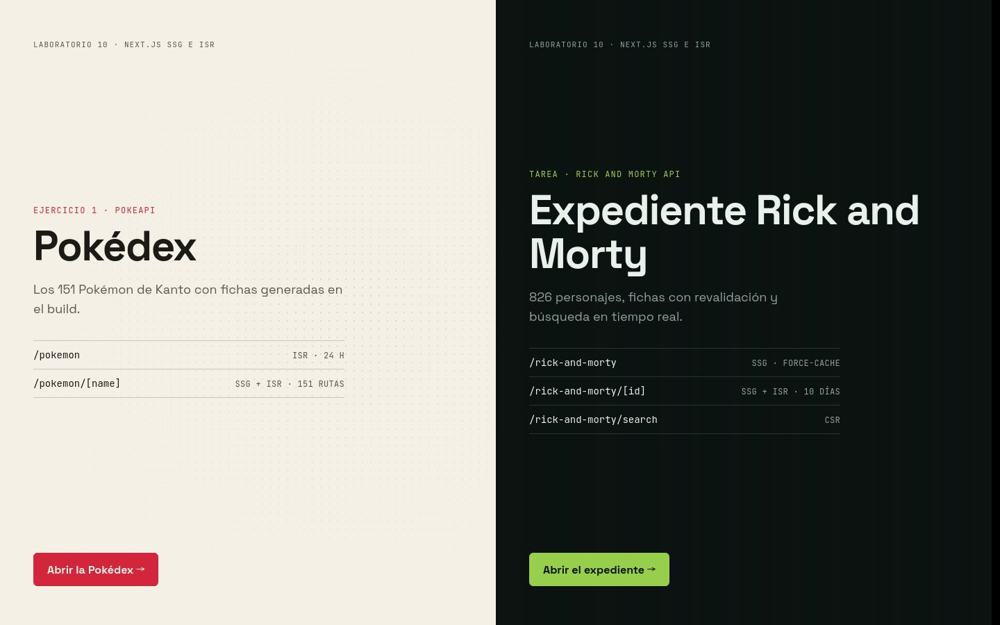

### Ejercicio 1: Pokédex

| Lista (`/pokemon`) | Ficha (`/pokemon/[name]`) |
|---|---|
| 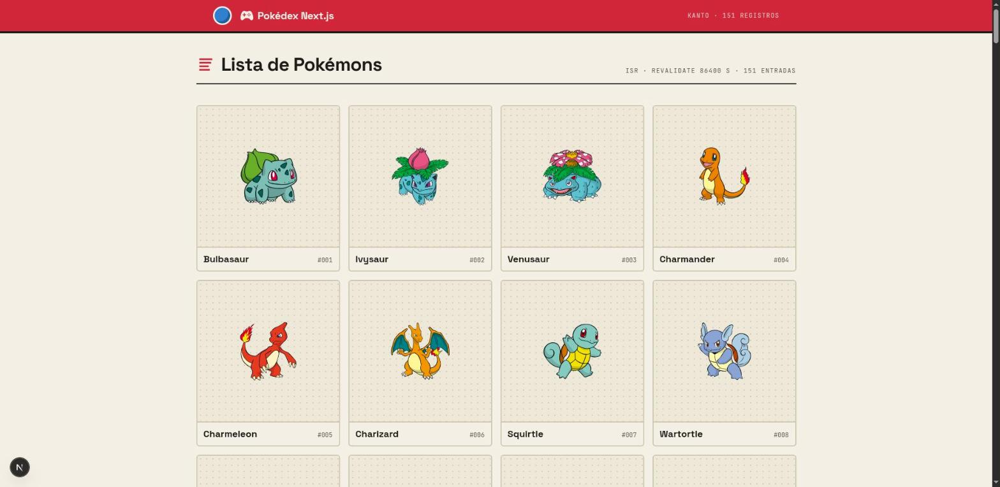 | 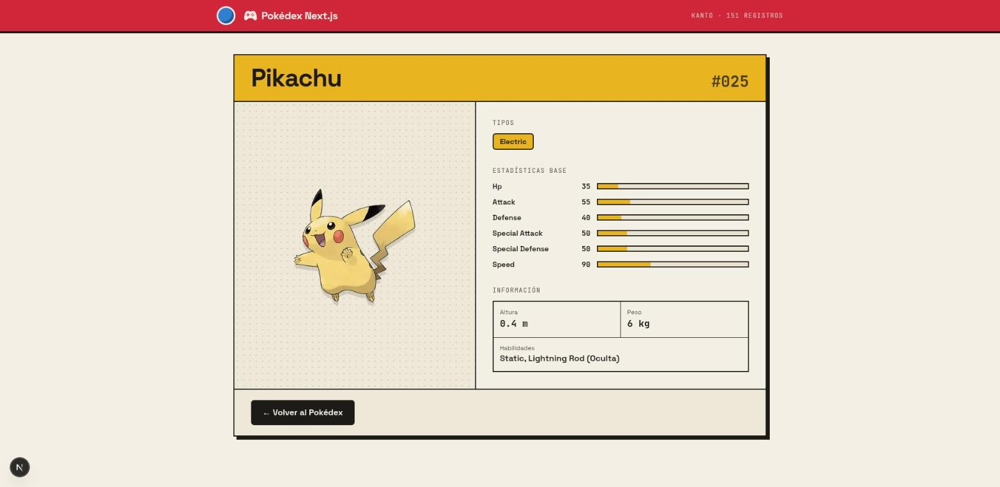 |

| Error Handler | NotFound Handler |
|---|---|
| 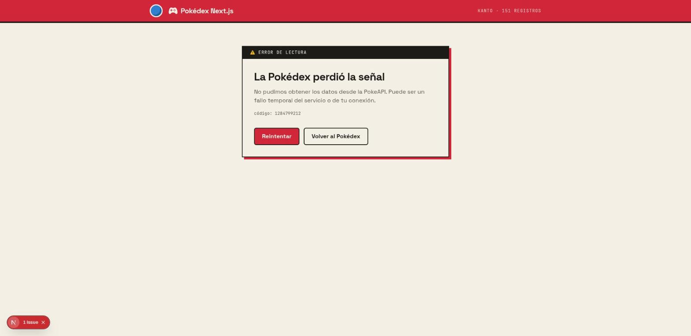 | 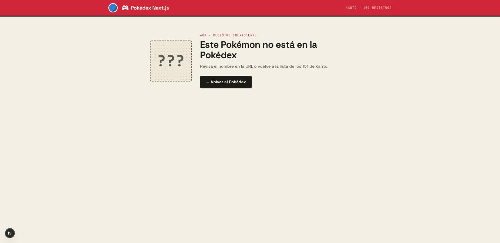 |

### Tarea: Rick and Morty

| Lista (`/rick-and-morty`) | Ficha (`/rick-and-morty/[id]`) |
|---|---|
| 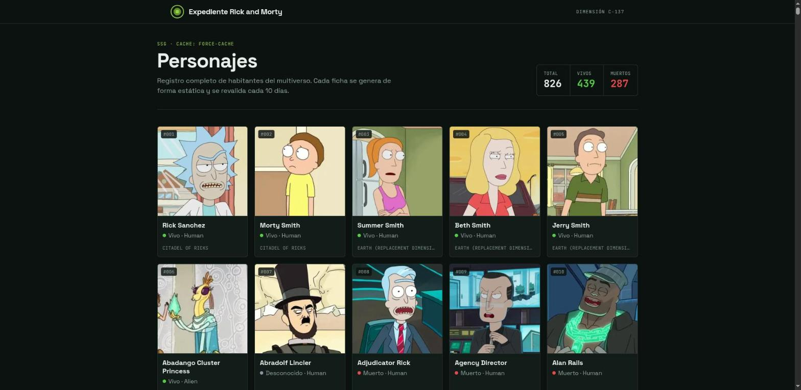 | 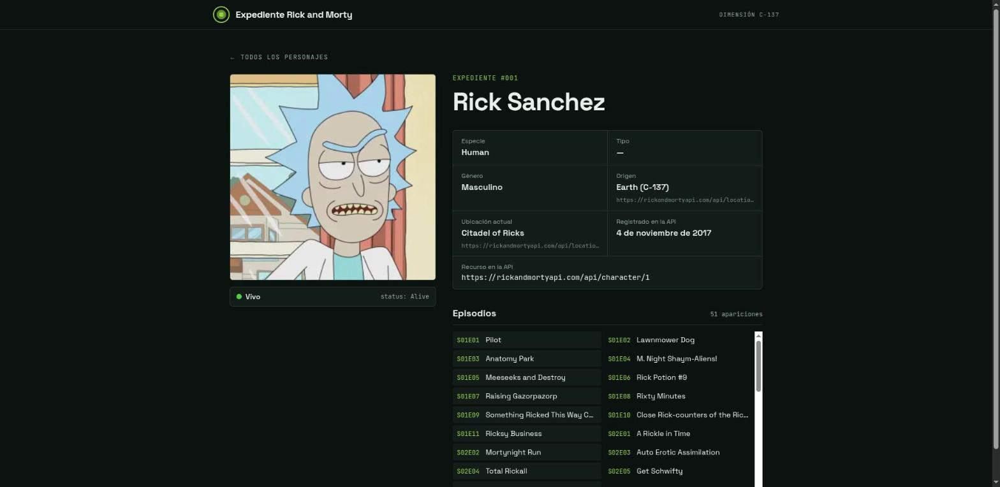 |

| Búsqueda por nombre, estado y género | Búsqueda por tipo y estado |
|---|---|
| 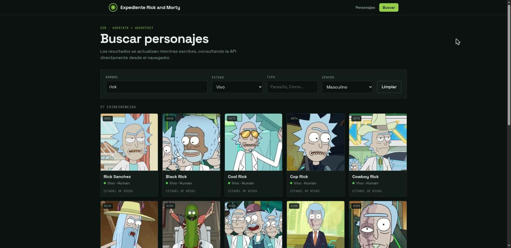 | 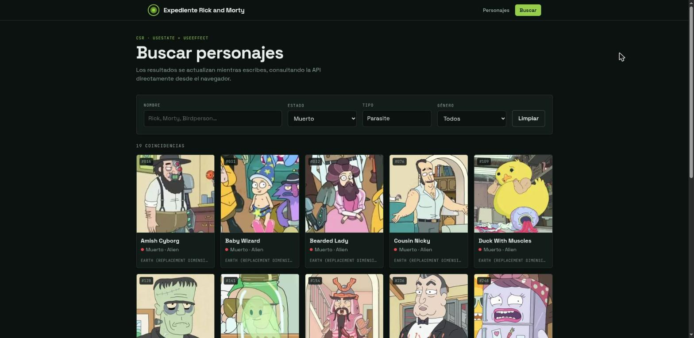 |

| Sin resultados | Personaje inexistente |
|---|---|
| 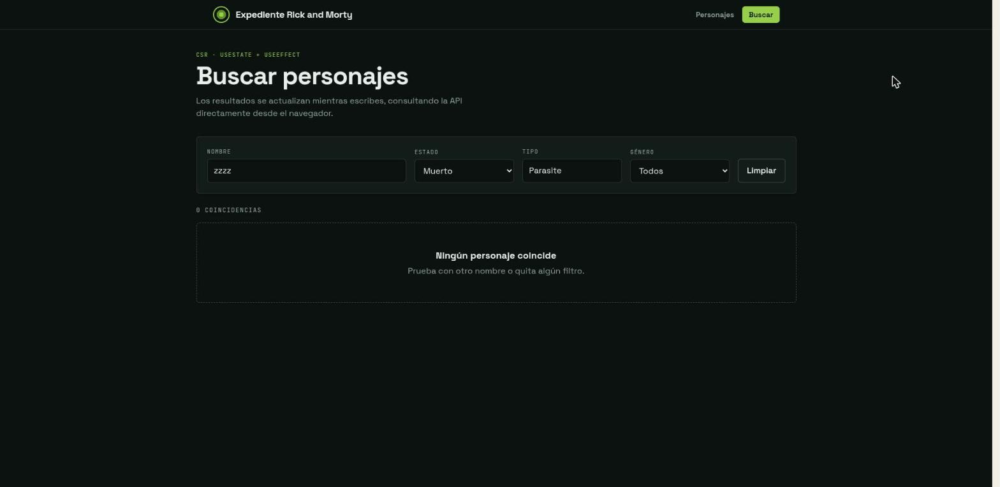 | 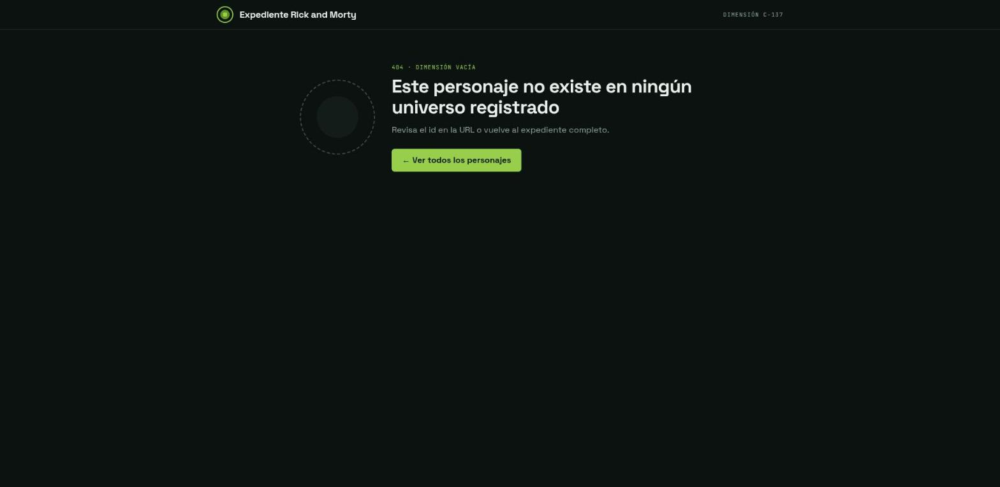 |

### Build de producción

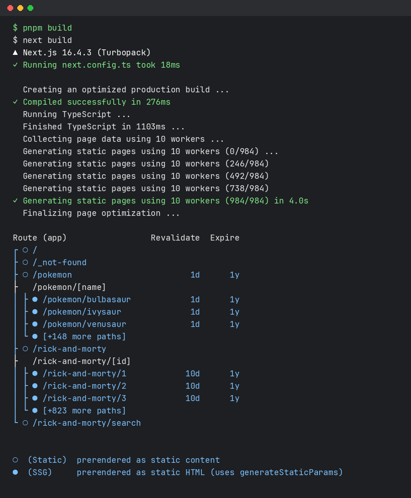
