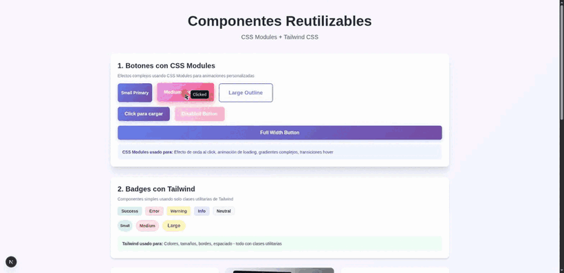
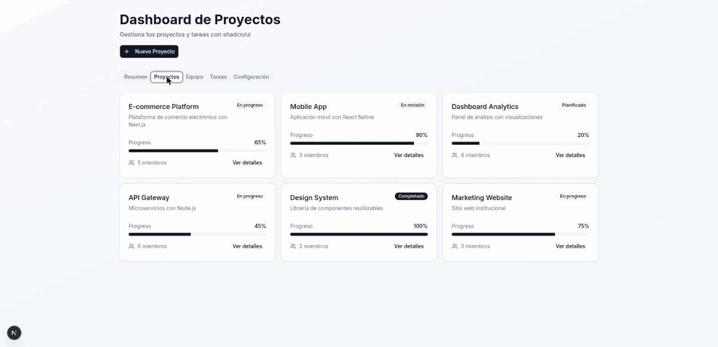
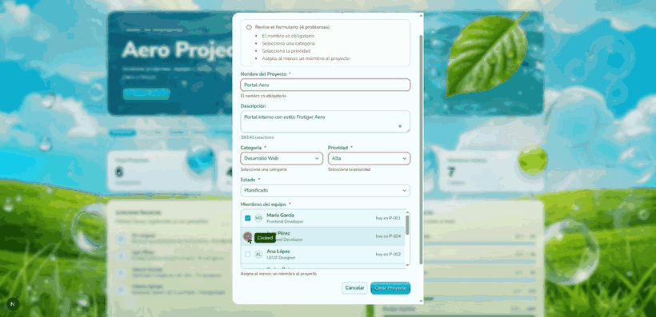
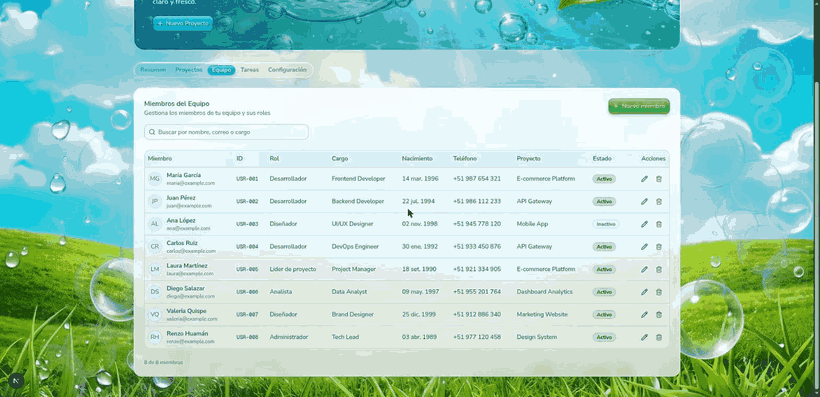
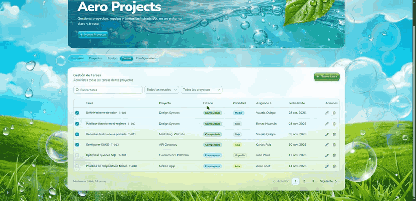
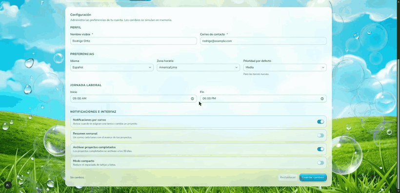

# Semana 11: Componentes y estilización (CSS Modules, Tailwind CSS y shadcn/ui)

Laboratorio 11 de Desarrollo de Aplicaciones Web Avanzado (DAWA), Tecsup. Contiene dos proyectos de Next.js:

| Carpeta | Contenido |
|---|---|
| [`next-components-styling/`](next-components-styling/) | Ejercicio 1: componentes reutilizables combinando CSS Modules y Tailwind CSS |
| [`next-shadcn-ui/`](next-shadcn-ui/) | Ejercicio 2 y Tarea: dashboard de proyectos con shadcn/ui, tema Frutiger Aero y lógica de negocio en memoria |

Stack: Next.js 16 (App Router, Turbopack), React 19, TypeScript, Tailwind CSS 4, shadcn/ui (Radix UI), react-day-picker, lucide-react y pnpm.

## Qué se desarrolló

### Ejercicio 1: CSS Modules + Tailwind CSS (`/styling`)

| Componente | Técnica | Por qué |
|---|---|---|
| `Button` | CSS Modules + Tailwind | Onda al hacer clic (`::before`), gradientes, animación de carga y `@keyframes` van en el módulo; tamaños, ancho y tipografía van con utilidades |
| `Card` | Solo Tailwind | Estructura estándar sin efectos que Tailwind no pueda expresar |
| `Badge` | Solo Tailwind | Variantes de color y tamaño resueltas con clases utilitarias |
| `Input` | CSS Modules + Tailwind | Etiqueta flotante, brillo al enfocar y animación de error en el módulo; layout y colores con Tailwind |

### Ejercicio 2: shadcn/ui (`/dashboard`)

Dashboard con pestañas (Resumen, Proyectos, Equipo, Tareas, Configuración), formulario de proyecto en un `Dialog` con `Select`, y tabla de tareas con `Checkbox` y `Badge`. Los componentes de `components/ui/` se copian al proyecto, por lo que se pueden modificar.

### Tarea: lógica de negocio del dashboard

Todo funciona con datos **en memoria** (se reinician al recargar la página), sin base de datos.

| Sección | Qué hace |
|---|---|
| Resumen | Métricas calculadas desde los datos: proyectos, tareas completadas y abiertas, miembros activos, actividad reciente y avance por proyecto |
| Proyectos | Crear y editar (con campo de **miembros del equipo**), **ver detalles**, **eliminar** con confirmación. El progreso se calcula con las tareas completadas |
| Equipo | CRUD con los campos `userId`, `role`, `name`, `email`, `position`, `birthdate`, `phone`, `projectId`, `isActive`, más búsqueda |
| Tareas | CRUD con `description`, `projectId`, `status`, `priority`, `userId`, `dateline`; **paginación**, filtros y casilla para completar |
| Configuración | Formulario con perfil, preferencias, jornada laboral e interruptores; guarda de forma simulada |

Componentes de shadcn/ui pedidos por la guía y dónde se usan:

| Componente | Uso |
|---|---|
| Spinner | En el botón de guardar y en el indicador "Sincronizando con el servidor…" mientras dura la petición simulada (0,9 s) |
| Alert | Resumen de errores de validación en cada formulario y avisos de éxito al guardar o eliminar |
| Calendar | Selector de fecha (Popover + Calendar, en español) para fecha de nacimiento y fecha límite |
| Pagination | Tabla de tareas, 6 por página, con puntos suspensivos |

Cambio de tema: se reemplazó la paleta neutra por un tema **Frutiger Aero** (cielo aqua, verde hoja, vidrio y brillo).

## Diseño e interacciones

- **Tokens de color en `oklch`** en `globals.css` (matiz 215–235 para agua y cielo, 140–150 para hoja) y clases propias del tema: `aero-glass`, `aero-gloss`, `aero-gloss-leaf`, `aero-progress`.
- **Imágenes** en `public/aero/` (WebP optimizado, ~1 MB en total): cielo, agua, hoja, burbujas y cuatro esferas. Las esferas, la hoja y las burbujas se recortaron para tener transparencia.
- **Efecto 3D:** las tarjetas se inclinan hacia el puntero con perspectiva y un brillo que lo sigue; las esferas sobresalen en el eje Z y flotan.
- **Paralaje:** el fondo, las dos capas de burbujas y la hoja de la cabecera se mueven a distinta velocidad con el puntero.
- **Tipografía:** dos familias, Nunito Sans (interfaz) y Geist Mono (cifras).
- **Accesibilidad:** si el sistema tiene activado "reducir movimiento", se desactivan flotación, inclinación, paralaje y barridos de brillo. Los campos con error usan `aria-invalid` y las acciones con icono tienen `aria-label`.

## Cómo ejecutarlo

```bash
cd semana11/next-shadcn-ui        # o next-components-styling
pnpm install
pnpm dev                          # desarrollo en http://localhost:3000
pnpm build && pnpm start          # build de producción
```

Rutas: `next-components-styling` en `/styling`; `next-shadcn-ui` en `/dashboard` (`/` redirige allí). No necesita variables de entorno.

## Decisiones técnicas

- **Datos en memoria con `useReducer` + Context** (`src/lib/data-context.tsx`). Las acciones son asíncronas y simulan latencia, lo que permite mostrar el Spinner sin backend.
- **Una sola fuente de verdad para la pertenencia a proyectos:** `member.projectId`. El campo "miembros" del formulario de proyecto edita esa asignación, por eso un miembro pertenece a un solo proyecto y se mueve al elegirlo en otro.
- **Integridad al borrar:** eliminar un proyecto elimina sus tareas y deja a sus miembros sin proyecto; eliminar un miembro deja sus tareas sin asignar.
- **Validación compartida** en `src/lib/rules.ts` (una sola definición para proyecto, miembro, tarea y configuración).
- **Estructura:** `src/lib` (tipos, datos semilla, reglas y contextos), `src/components/ui` (shadcn), `src/components/forms` (Field, FormAlert, DatePicker, SubmitButton, ConfirmDialog), `src/components/aero` (efectos del tema) y `src/components/dashboard` (pestañas).

## Problemas resueltos

- **Espacios de no separación del Word.** El código copiado de la guía venía sangrado con espacios U+00A0 y Turbopack rechazaba el CSS (`Unexpected token Ident("animation")`). Se reemplazaron por espacios normales.
- **CSS Modules sin estilos.** La plantilla de Next 16 registra el loader de Tailwind para todo `*.css` con `as: "*.css"`, lo que convertía los `*.module.css` en CSS global y dejaba `styles.button` como `undefined` (botones blancos sobre fondo blanco). Se excluyeron los módulos en `next.config.ts` con `condition: { not: { path: /\.module\.css$/ } }`.
- **CLI de shadcn más nueva que la guía.** La versión instalada (4.23) ya no pregunta el color base: pide una base de componentes y un preset. Se usó `--base radix --preset vega` y se ajustaron `baseColor: "slate"` y la paleta en `globals.css`. El componente `form` ya no se genera, pero la guía no lo usa.
- **Archivo de la tabla.** La guía nombra `TaskTable.tsx` pero lo importa como `@/components/TasksTable`; se usó `TasksTable.tsx`.
- **`AGENTS.md`.** `next dev` lo regenera en cada proyecto; se agregó a `.gitignore` para no subirlo.

## Evidencias

Cada GIF muestra solo el resultado final de cada parte, grabado con la aplicación en ejecución.

### Ejercicio 1: CSS Modules + Tailwind CSS (`/styling`)

Efecto de onda al hacer clic, estado de carga del botón y validación del email con animación de error.



### Ejercicio 2: dashboard con shadcn/ui (`/dashboard`)

Resumen, Proyectos, Equipo, Tareas y el diálogo del formulario de proyecto.



### Tarea: dashboard con tema Frutiger Aero

**Proyectos:** validación con Alert, guardado con Spinner, aviso de proyecto creado (el total del Resumen sube a 7), detalles y eliminación con confirmación.



**Equipo y Calendar:** tabla con los campos del miembro, formulario y selector de fecha de nacimiento.



**Tareas:** lista con filtros, paginación (página 2) y validación del formulario.



**Configuración:** validación, guardado con Spinner y aviso de configuración guardada.


