# Semana 12: API Routes con Next.js, Prisma y Supabase

Laboratorio 12 de Desarrollo de Aplicaciones Web Avanzado (DAWA), Tecsup. Proyecto en [`next-api-routes/`](next-api-routes/).

Stack: Next.js 16 (App Router), Prisma 7, PostgreSQL en Supabase y pnpm.

## Objetivo

Construir una API REST con las API Routes de Next.js (App Router) que persiste datos en PostgreSQL mediante Prisma, y consumirla desde una interfaz propia. El dominio es un sistema de biblioteca: autores y libros.

## Modelo de datos

Dos modelos con relación uno a muchos (un autor tiene varios libros), definidos en `prisma/schema.prisma`.

| Modelo | Campos principales | Restricciones |
|---|---|---|
| `Author` | `id`, `name`, `email`, `bio`, `nationality`, `birthYear`, `imageUrl` | `email` único |
| `Book` | `id`, `title`, `description`, `isbn`, `publishedYear`, `genre`, `pages`, `authorId` | `isbn` único; al borrar un autor se borran sus libros (`onDelete: Cascade`); índices en `authorId`, `genre` y `title` |

En Prisma 7 la URL de conexión no va en el esquema sino en `prisma.config.ts`, y el cliente usa el adaptador `pg`. La cadena de conexión se lee de la variable `DATABASE_URL`, que nunca se versiona (el repositorio solo incluye `.env.example`).

## Endpoints

| Método y ruta | Función |
|---|---|
| `GET /api/authors` | Lista autores con su cantidad de libros |
| `POST /api/authors` | Crea un autor (201) |
| `GET /api/authors/[id]` | Obtiene un autor |
| `PUT /api/authors/[id]` | Actualiza un autor |
| `DELETE /api/authors/[id]` | Elimina un autor y sus libros |
| `GET /api/authors/[id]/books` | Libros de un autor |
| `GET /api/authors/[id]/stats` | Estadísticas del autor: total de libros, primer y último libro, promedio de páginas, géneros, libro más largo y más corto |
| `GET /api/books` | Lista libros; admite `?genre=` |
| `POST /api/books` | Crea un libro asociado a un autor (201) |
| `GET /api/books/[id]` | Obtiene un libro con su autor |
| `PUT /api/books/[id]` | Actualiza un libro |
| `DELETE /api/books/[id]` | Elimina un libro |
| `GET /api/books/search` | Búsqueda por título (sin distinguir mayúsculas), filtros por género y autor, orden (`sortBy`, `order`) y paginación (`page`, `limit`, tope de 50) |
| `GET /api/stats` | Cifras generales para el dashboard |

Los errores se devuelven como `{ "error": "..." }` con el código adecuado: 404 si el registro no existe, 409 si se viola una restricción única (email o ISBN) y 400 si el autor indicado no existe. La traducción de los códigos de Prisma (`P2002`, `P2025`, `P2003`) está centralizada en `src/lib/http.ts`.

## Interfaz

Tres pantallas que consumen la API con `fetch`:

- **Dashboard (`/`):** estadísticas generales y galería de autores, con crear, editar y eliminar.
- **Libros (`/books`):** búsqueda en vivo con retardo de 300 ms, filtros por género y autor, orden, paginación y formularios en diálogos. Es responsive.
- **Ficha del autor (`/authors/[id]`):** datos, estadísticas, sus libros y alta de libros con el autor ya fijado.

Los estilos están separados en `src/styles/` (`tokens.css`, `base.css`, `components.css`, `pages.css`) y los componentes reutilizables en `src/components/`.

## Cómo ejecutarlo

```bash
cd semana12/next-api-routes
cp .env.example .env      # completar DATABASE_URL (Session pooler de Supabase)
pnpm install
pnpm exec prisma db push  # crea las tablas
pnpm dev                  # http://localhost:3000
```

`scripts/probar-api.sh` ejecuta con `curl` las pruebas de los endpoints, en el mismo orden de las evidencias.

## Evidencias

### Base de datos

Proyecto en Supabase (identificador y claves ocultos).

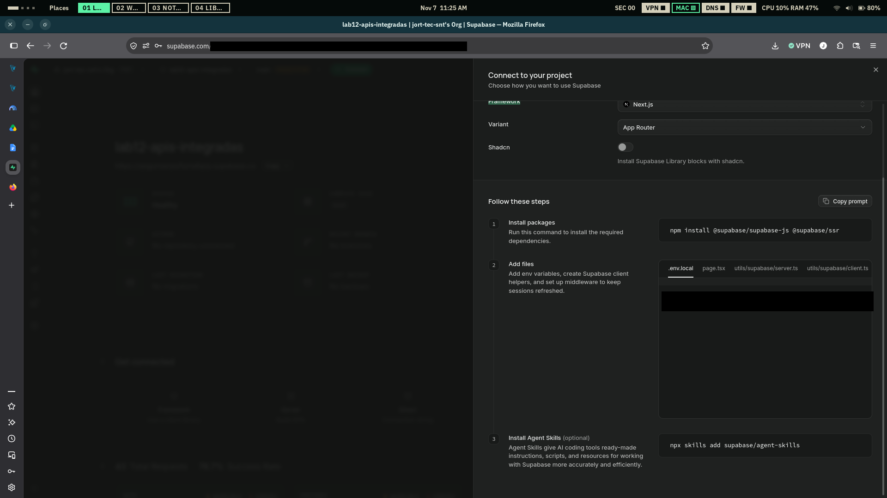

Conexión a Supabase (Session pooler) desde DBeaver.

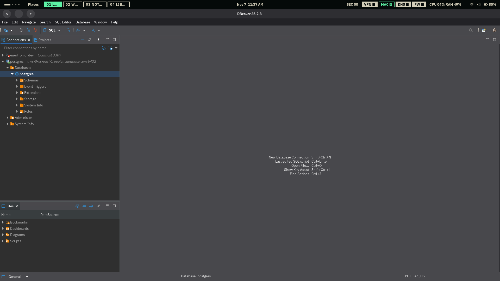

Tablas `Author` y `Book` y su relación.

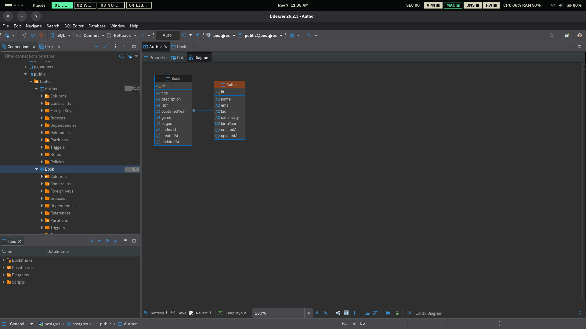

Tabla `Book` con registros en el Table Editor de Supabase.

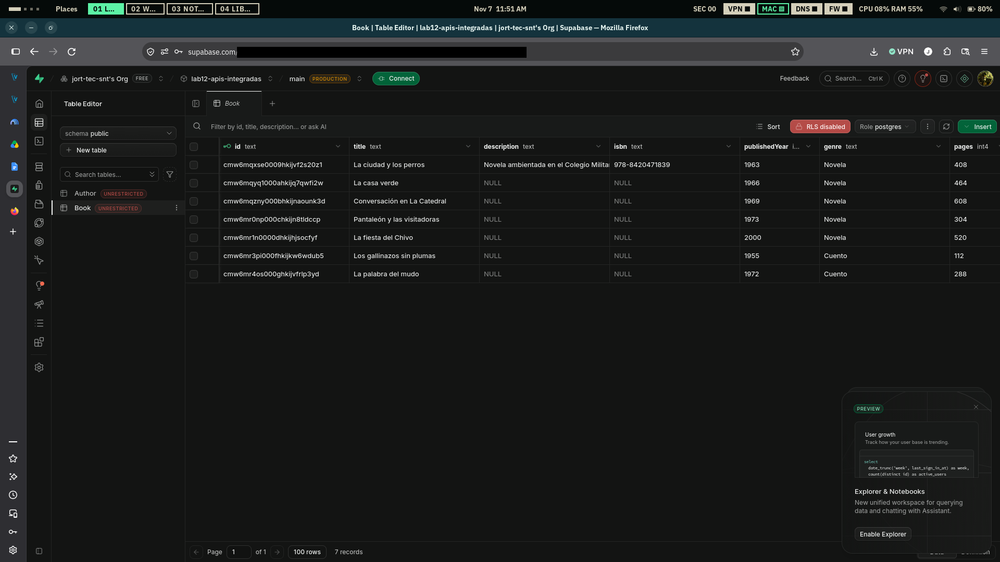

### Vista móvil (390 px de ancho)

| Dashboard | Galería de autores |
|---|---|
|  | 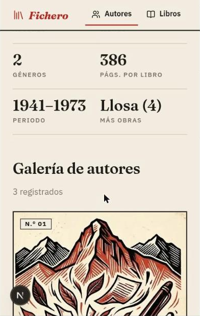 |

| Libros: filtros | Libros: lista |
|---|---|
| 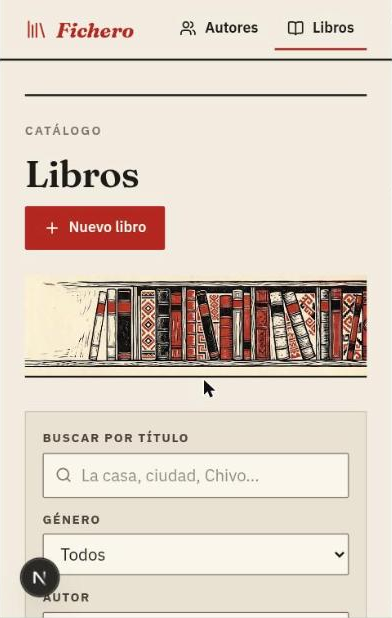 | 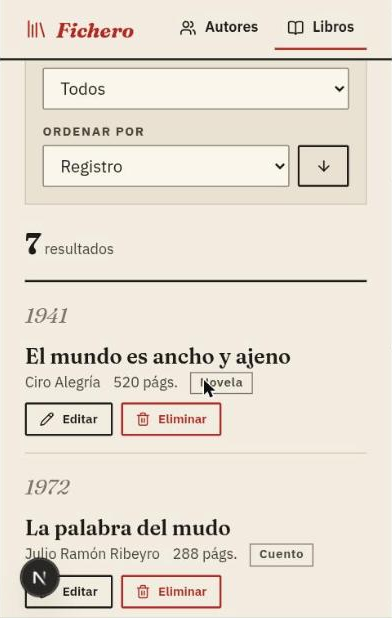 |

| Ficha del autor |
|---|
|  |

### Pruebas de la API

#### 1. `GET /api/authors`: listar autores

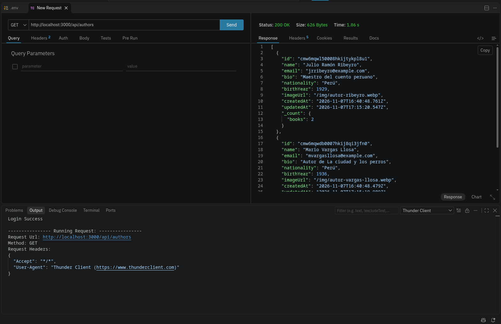

#### 2. `POST /api/authors`: crear autor

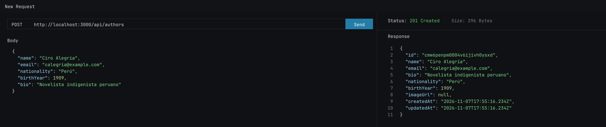

#### 3. `GET /api/authors/[id]`: autor por ID

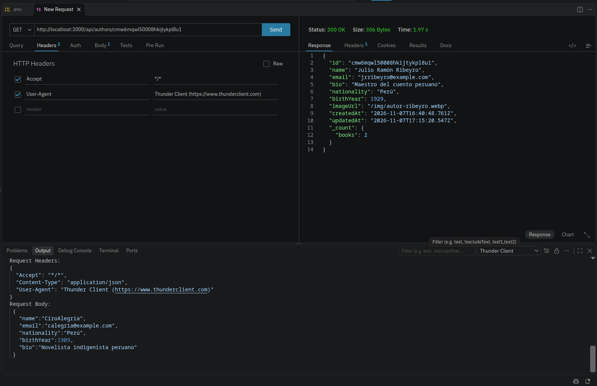

#### 4. `PUT /api/authors/[id]`: actualizar autor

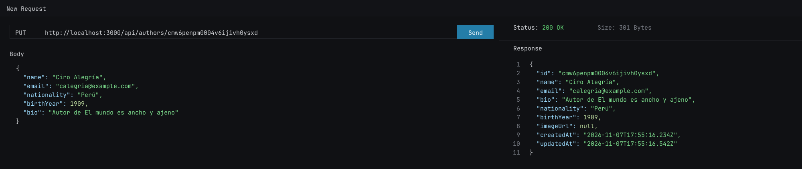

#### 5. `POST /api/books`: crear libro

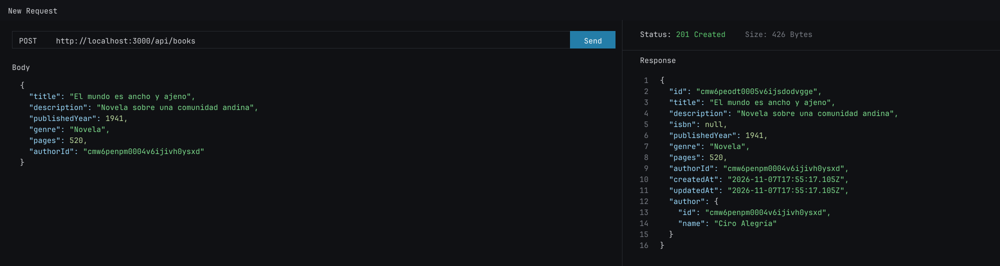

#### 6. `GET /api/books`: listar libros

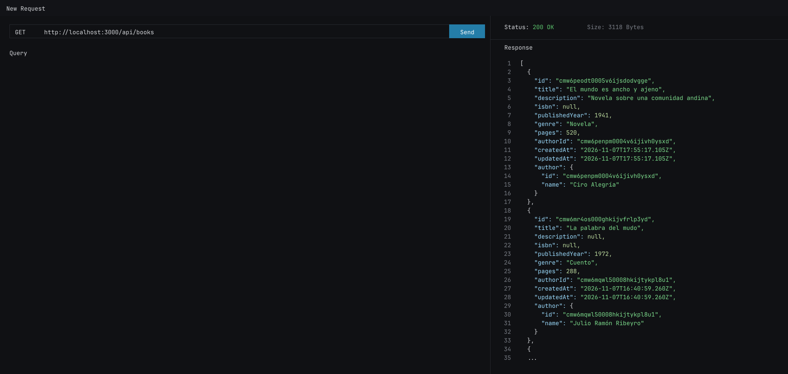

#### 7. `GET /api/books?genre=Novela`: filtrar por género

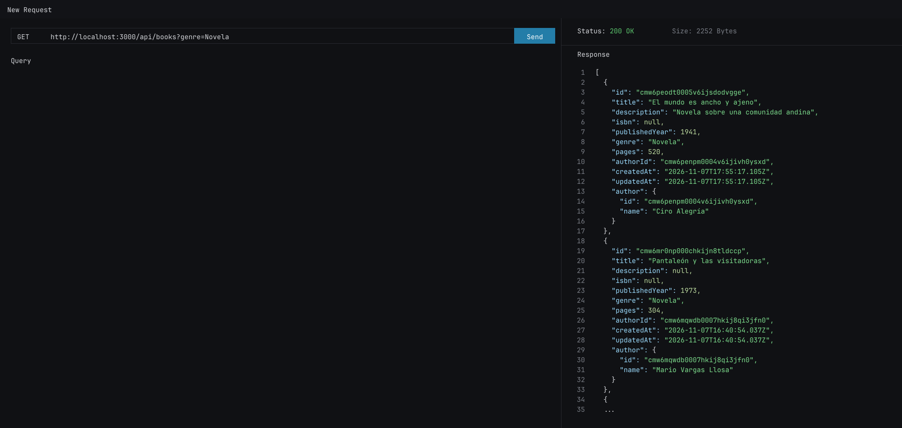

#### 8. `GET /api/books/[id]`: libro por ID

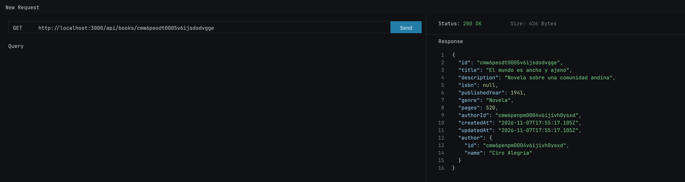

#### 9. `GET /api/authors/[id]/books`: libros de un autor

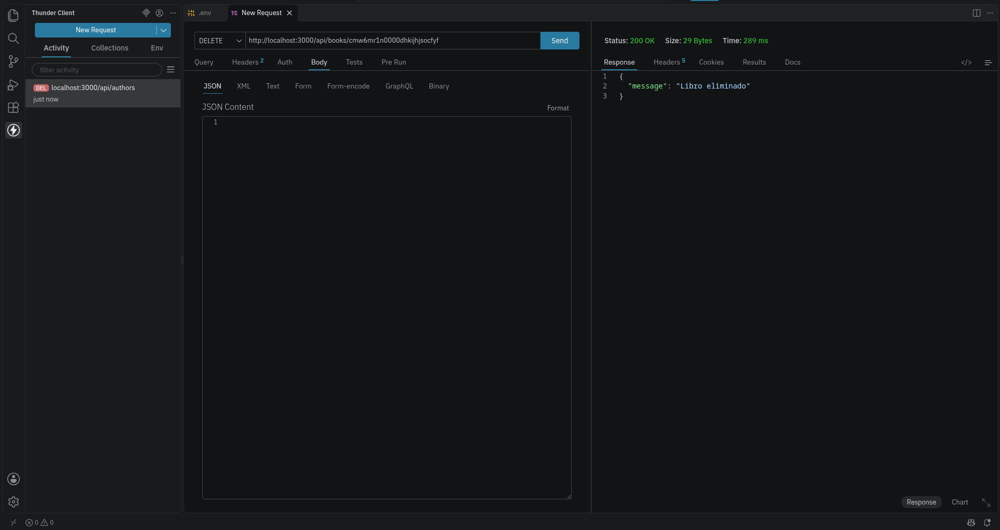

#### 10. `DELETE /api/books/[id]`: eliminar libro

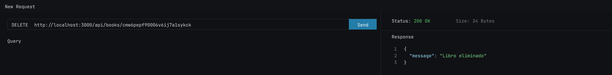

#### 11. `GET /api/books/search`: búsqueda, filtros, paginación y orden

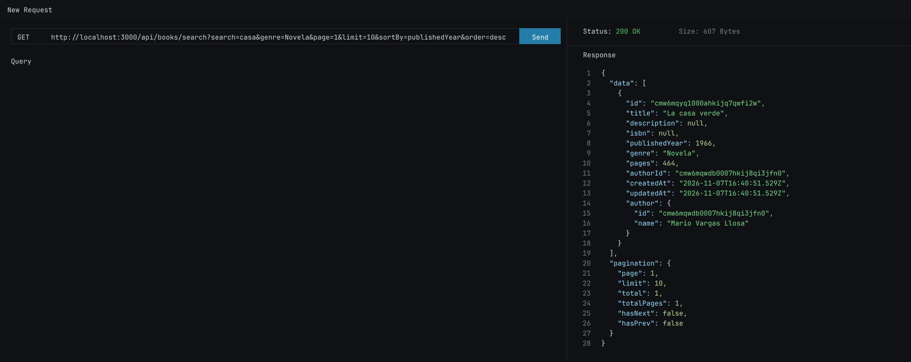

#### 12. `GET /api/authors/[id]/stats`: estadísticas del autor

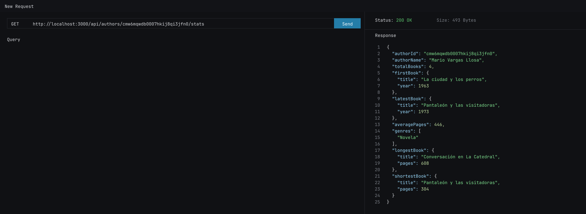
