# AeroGate · Laboratorio 13: Autenticación y seguridad con NextAuth.js

Portal de acceso en Next.js (App Router) con **Google OAuth**, **GitHub OAuth** y **credenciales propias**
(registro, bcrypt y bloqueo por intentos). Interfaz de estilo Frutiger Aero.

## Stack
Next.js 16 · NextAuth.js 4 (sesión JWT) · Prisma 7 + PostgreSQL (Supabase) · bcryptjs · Tailwind CSS 4 · pnpm

## Funcionalidad
| Requisito del laboratorio | Dónde está |
|---|---|
| Google OAuth | `src/lib/auth.ts` (`GoogleProvider`) |
| GitHub OAuth (tarea) | `src/lib/auth.ts` (`GitHubProvider`) |
| Login con credenciales (tarea) | `src/lib/auth.ts` (`CredentialsProvider`) |
| Formulario de registro (tarea) | `src/app/register/page.tsx` y `src/app/api/register/route.ts` |
| Cifrado con bcrypt (tarea) | 12 rondas, en el registro y en la verificación |
| Bloqueo tras varios intentos (tarea) | 5 fallos seguidos bloquean la cuenta 15 minutos (`MAX_ATTEMPTS`, `LOCK_MINUTES`) |
| Protección de rutas | `src/proxy.ts` + mapa en `src/lib/routes.ts` |

### Mapa de rutas
| Ruta | Sin sesión | Con sesión |
|---|---|---|
| `/dashboard`, `/profile` | redirige a `/signIn?callbackUrl=...` | acceso |
| `/signIn`, `/register` | acceso | redirige a `/dashboard` |
| `/api/register` | acceso | 403 |

### Diferencias respecto a la guía
- `authOptions` está en `src/lib/auth.ts`: un `route.ts` de Next.js solo puede exportar handlers HTTP.
- Next.js 16 renombró `middleware` a `proxy`, por eso el archivo es `src/proxy.ts`.
- El `callbackUrl` se valida para aceptar solo rutas internas (evita open redirect).

## Ejecución local
```bash
pnpm install
cp .env.example .env      # completar los valores
pnpm exec prisma db push  # crea la tabla User
pnpm dev
```

Variables (ver `.env.example`): `DATABASE_URL`, `GOOGLE_CLIENT_ID`, `GOOGLE_CLIENT_SECRET`, `GITHUB_ID`,
`GITHUB_SECRET`, `NEXTAUTH_URL`, `NEXTAUTH_SECRET`.

URLs de callback: `<NEXTAUTH_URL>/api/auth/callback/google` y `<NEXTAUTH_URL>/api/auth/callback/github`.

## Estructura
- `src/lib`: `auth.ts` (opciones de NextAuth), `routes.ts` (mapa de rutas), `prisma.ts`.
- `src/components`: `Navbar`, `Field`, `LogoutButton`, `SessionProvider`.
- `src/styles`: `tokens.css`, `base.css`, `components.css`, `pages.css`.
- `public/aero`: imágenes del tema (WebP).

## Evidencias
Capturas en [`../capturas`](../capturas/).

### Interfaz y rutas protegidas
**Pantalla de acceso** (`/signIn`): credenciales, Google y GitHub.

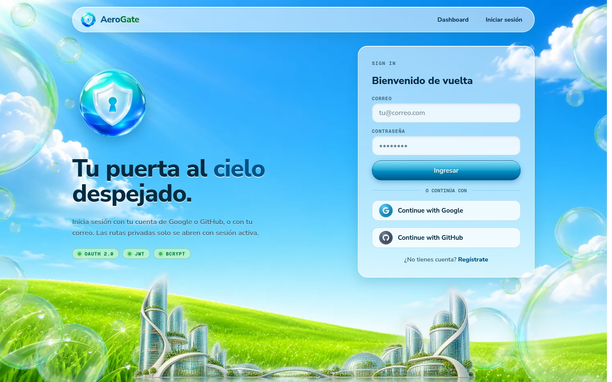

**Dashboard** con la sesión iniciada: método de acceso, tipo de sesión y mapa de rutas.

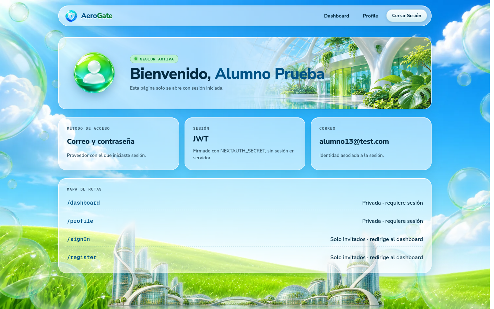

**Perfil** (`/profile`).


**Ruta protegida:** sin sesión, `/dashboard` redirige a `/signIn?callbackUrl=%2Fdashboard`.

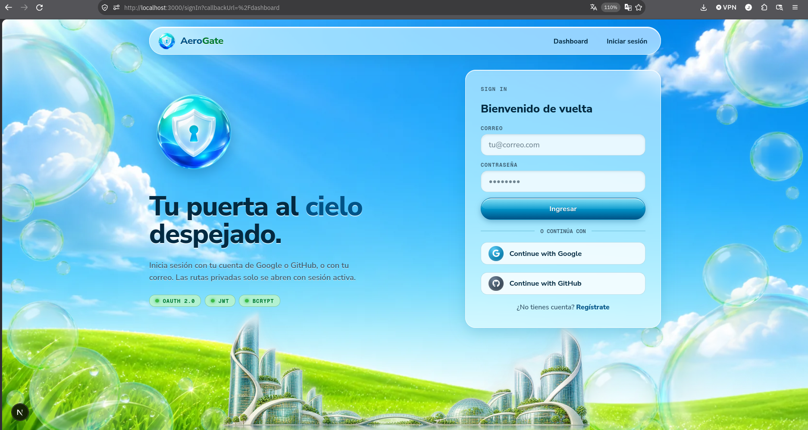

**Ruta solo para invitados:** con sesión activa, `/signIn` redirige a `/dashboard`. La etiqueta inferior muestra la URL final, porque la captura se tomó en modo headless.

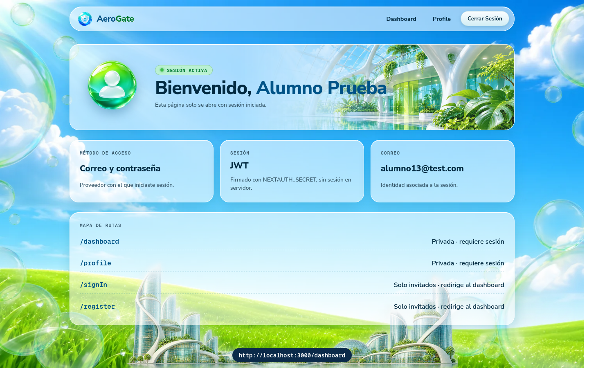

### Credenciales: registro, errores y bloqueo
**Formulario de registro** (`/register`), vacío y con datos.


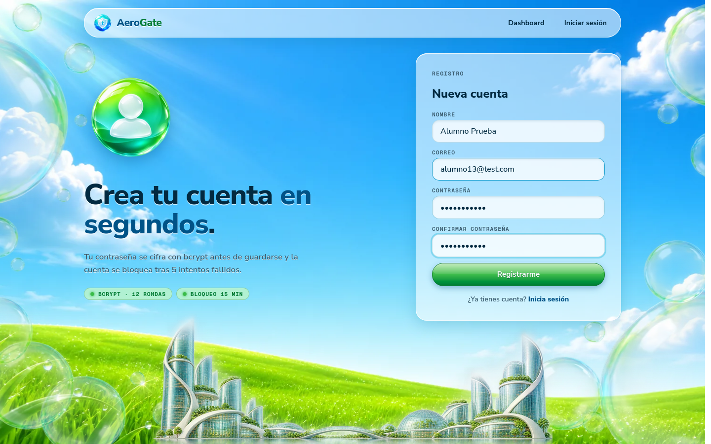

**Contraseña incorrecta:** el mensaje indica los intentos restantes.

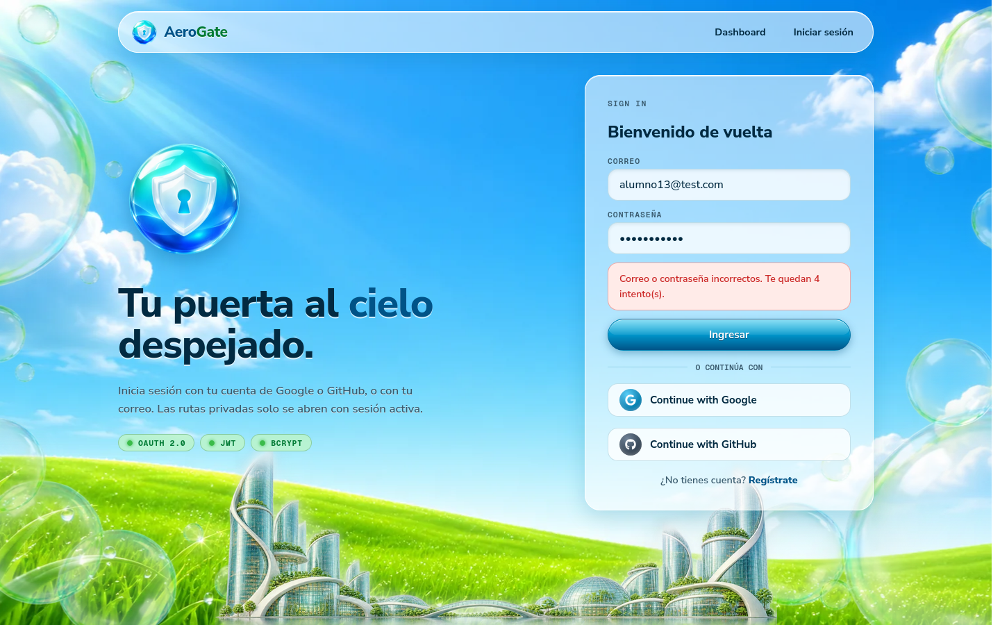

**Bloqueo:** tras 5 intentos fallidos la cuenta se bloquea 15 minutos, incluso con la contraseña correcta.


### Producción (Vercel)
Aplicación desplegada: <https://next-auth-app-ortizdev-x86.vercel.app>

| Ajuste | Valor |
|---|---|
| Repositorio y rama | `jort-tec-snt/WEB_AVANZADO_ORTIZ`, rama `main` |
| Root Directory | `semana13/next-auth-app` |
| Framework | Next.js (build: `prisma generate && next build`) |
| Variables de entorno | `DATABASE_URL`, `GOOGLE_CLIENT_ID`, `GOOGLE_CLIENT_SECRET`, `GITHUB_ID`, `GITHUB_SECRET`, `NEXTAUTH_URL`, `NEXTAUTH_SECRET` (cargadas en Vercel, nunca en el repositorio) |
| OAuth en producción | cliente de Google y OAuth App de GitHub propios de producción, con las callbacks del dominio de Vercel |

#### Problemas encontrados al desplegar
1. **`[NO_SECRET] Please define a 'secret' in production`:** las páginas respondían 500 porque `NEXTAUTH_SECRET` no llegó a Vercel al pegar el `.env`. Se agregó a mano como variable de producción.
2. **`TypeError: Invalid URL` en `assertConfig`:** `NEXTAUTH_URL` tenía un formato inválido. Se reescribió como `https://<dominio>` sin comillas ni barra final y se hizo un nuevo despliegue.
3. **`Error 400: redirect_uri_mismatch` de Google:** el cliente de OAuth solo conocía `localhost`. Se creó un cliente de producción con el origen y la callback del dominio de Vercel.
4. **GitHub `OAuthSignin`:** faltaban `GITHUB_ID` y `GITHUB_SECRET`, porque una OAuth App de GitHub admite una sola callback. Se creó una segunda app para producción.

Los cambios en variables de entorno solo aplican tras un nuevo despliegue (Redeploy).

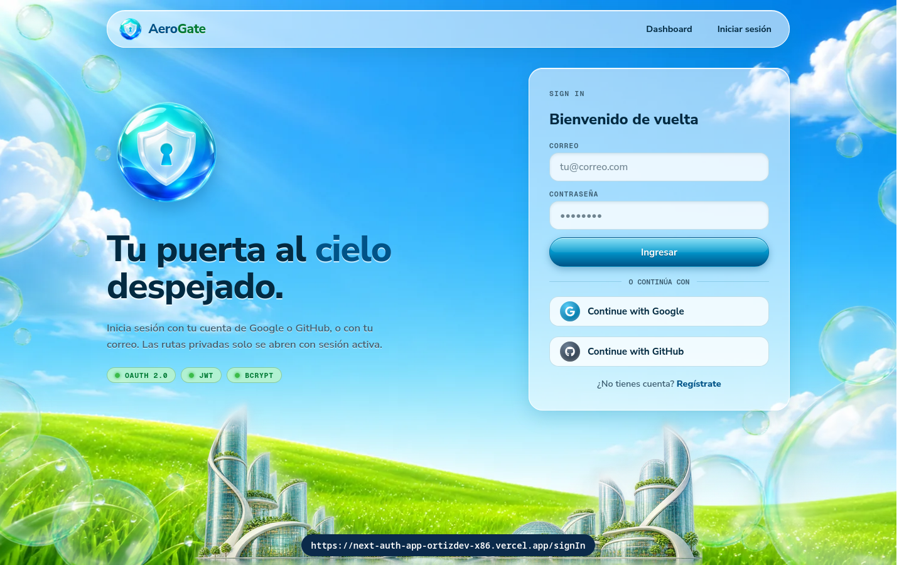
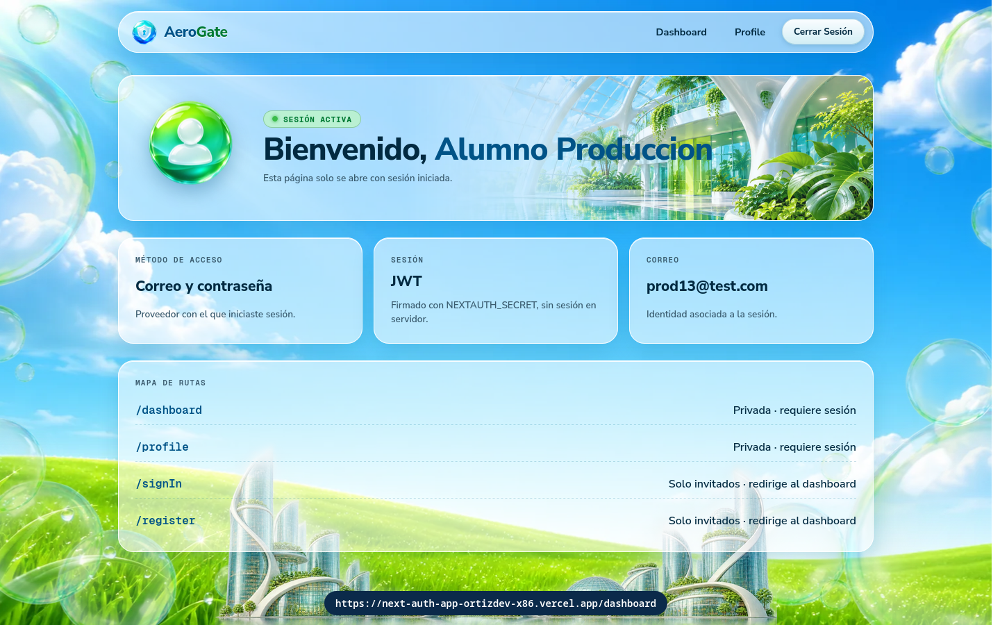
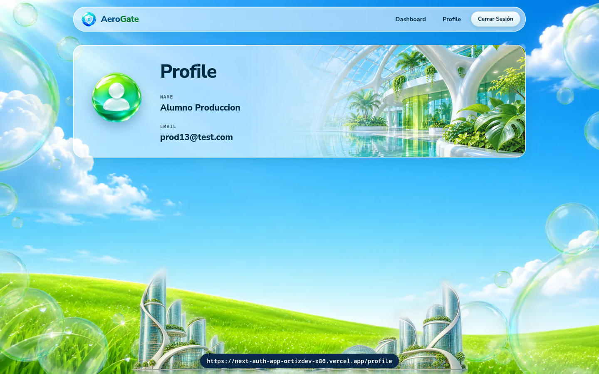
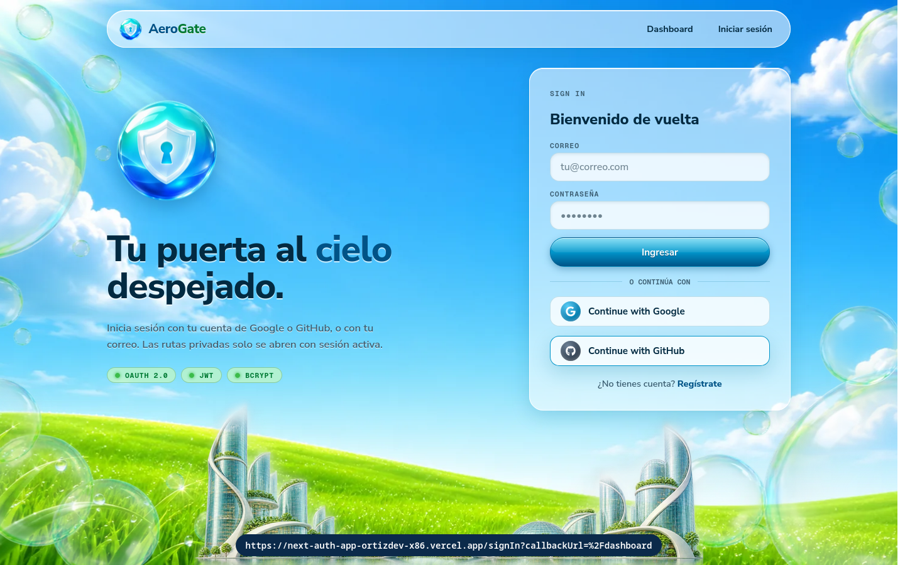
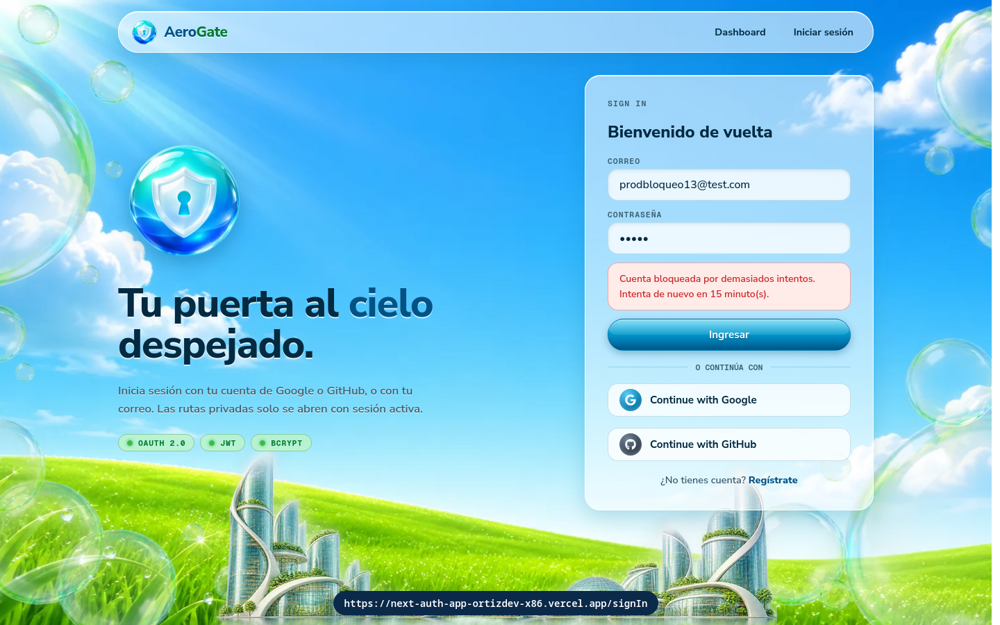

Las capturas del acceso con Google y GitHub en producción usan cuentas personales y se incluyen solo en el informe académico.

### Vista móvil
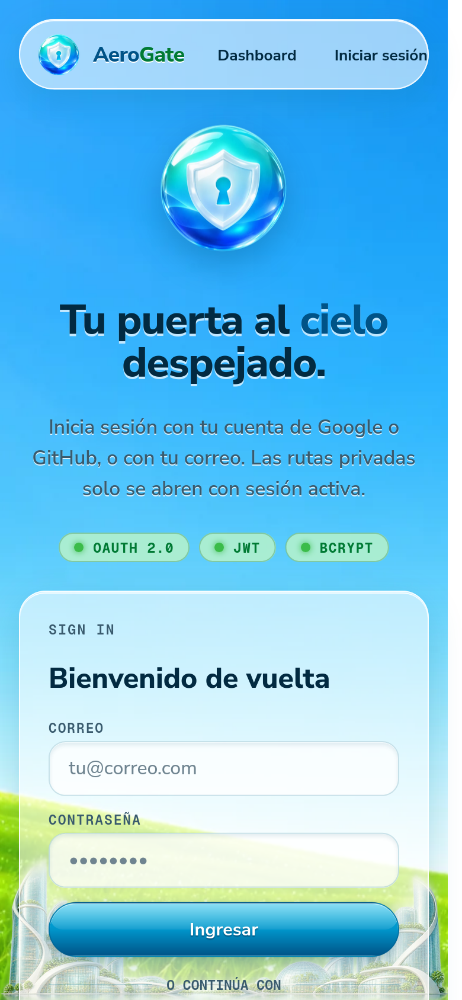 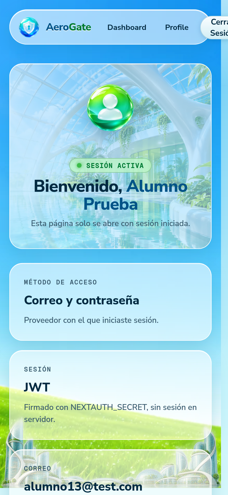

## Entrega
- Repositorio: <https://github.com/jort-tec-snt/WEB_AVANZADO_ORTIZ/tree/main/semana13/next-auth-app>
- Despliegue en Vercel: <https://next-auth-app-ortizdev-x86.vercel.app>
