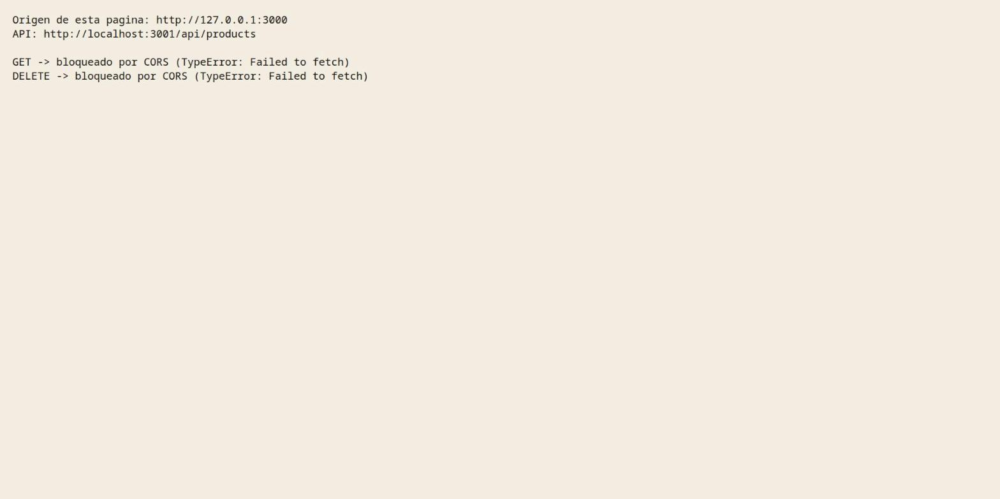
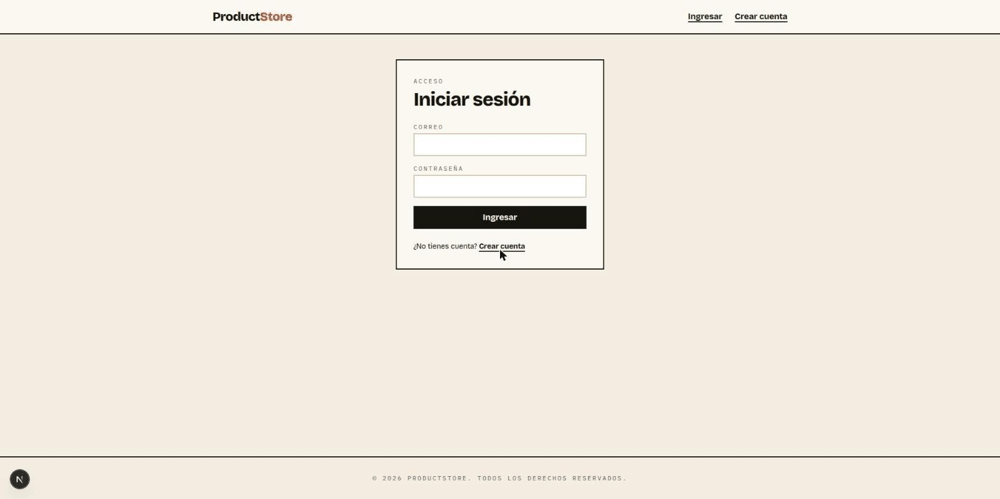

# Semana 15: Conexión backend y frontend (Mini Marketplace)

Laboratorio 15 de Desarrollo de Aplicaciones Web Avanzado (DAWA), Tecsup.

| Carpeta | Contenido |
|---|---|
| [`backend-marketplace`](backend-marketplace/) | API REST con Express 5, Sequelize y MySQL |
| [`frontend-marketplace`](frontend-marketplace/) | Next.js 16 (App Router), TypeScript y Tailwind CSS 4 |

Se usa **pnpm** en lugar de `npm`/`npx`.

## Estado

| Parte de la guía | Estado |
|---|---|
| 1. Base de datos | MariaDB local. Base en la nube pendiente |
| 2. Backend | Hecho y probado |
| 3. Frontend | Hecho y probado |
| Tarea: usuarios, roles, login y protección de rutas | Hecho en local |
| Tarea: categorías, imagen y filtro | Pendiente |
| Tarea: CORS restringido | Hecho en local; falta el dominio de Vercel |
| Tarea: despliegue en Render y Vercel | Pendiente |

## Guía de usuario: practicar el laboratorio

Todos los valores son de ejemplo: cada persona crea **su propia base de datos y su propia clave**. Los archivos `.env` y `.env.local` no se suben al repositorio.

### Requisitos

- Node.js 18.18 o superior (probado con Node 24)
- pnpm (probado con pnpm 12)
- MariaDB (probado con 12.3 en Linux)
- Git

### 1. Descargar el proyecto

```bash
git clone https://github.com/jort-tec-snt/WEB_AVANZADO_ORTIZ.git
cd WEB_AVANZADO_ORTIZ/semana15
```

### 2. Preparar la base de datos (terminal 1)

En Linux, sin permisos de administrador. La primera línea de `mariadb-install-db` se ejecuta una sola vez.

```bash
D=$HOME/.local/share/dawa-s15-db
mkdir -p $D
mariadb-install-db --no-defaults --datadir=$D/data --auth-root-authentication-method=normal
mariadbd --no-defaults --datadir=$D/data --socket=$D/mysql.sock --port=3307 --bind-address=127.0.0.1
```

Deja esa terminal abierta. En otra, entra como administrador:

```bash
mariadb --no-defaults -S $HOME/.local/share/dawa-s15-db/mysql.sock -u root
```

Y ejecuta, cambiando `cambia_esta_clave` por una clave tuya:

```sql
CREATE DATABASE marketplace CHARACTER SET utf8mb4;
CREATE USER 'marketplace'@'127.0.0.1' IDENTIFIED BY 'cambia_esta_clave';
GRANT ALL ON marketplace.* TO 'marketplace'@'127.0.0.1';
EXIT;
```

Esta instancia es solo para practicar: el usuario `root` no tiene clave y el servidor escucha únicamente en `127.0.0.1`. En Windows o macOS, usa tu MariaDB instalada, ejecuta el mismo SQL y ajusta `DB_PORT` (normalmente 3306).

### 3. Levantar el backend (terminal 2)

Desde `semana15`:

```bash
cd backend-marketplace
cp .env.example .env      # escribe tu clave en DB_PASSWORD
pnpm install
pnpm dev                  # http://localhost:3001
```

Espera el mensaje `Servidor corriendo en http://localhost:3001`.

Crea las cuentas de prueba con **tus propias claves** (solo la primera vez, desde otra terminal en `backend-marketplace`):

```bash
cp .env.seed.example .env.seed   # escribe una clave de 8 o más caracteres para cada cuenta
pnpm seed:users
```

En desarrollo `JWT_SECRET` puede quedar vacío: se genera una clave temporal y las sesiones se cierran al reiniciar el backend. Para evitarlo, pon en el `.env` el resultado de `openssl rand -hex 48`.

También solo la primera vez, desde otra terminal en `backend-marketplace`, carga los productos de prueba (pedirá tu clave):

```bash
mariadb -h 127.0.0.1 -P 3307 -u marketplace -p marketplace < database/seed.sql
```

### 4. Levantar el frontend (terminal 3)

Desde `semana15`:

```bash
cd frontend-marketplace
cp .env.example .env.local
pnpm install
pnpm dev                  # http://localhost:3000
```

### 5. Usar la aplicación

| Qué hacer | Dónde | Rol |
|---|---|---|
| Crear una cuenta | `/register` (siempre queda como `CUSTOMER`) | Visitante |
| Iniciar sesión | `/login` con una cuenta de tu `.env.seed` | Visitante |
| Ver el catálogo y el detalle | `/` y clic en un producto | `CUSTOMER`, `ADMIN` |
| Crear un producto | `/admin`: completa el formulario y pulsa **Crear** | `ADMIN` |
| Editar | `/admin`: **Editar**, cambia los datos y pulsa **Actualizar** | `ADMIN` |
| Eliminar | `/admin`: **Eliminar** y luego **¿Confirmar?** | `ADMIN` |
| Cerrar sesión | **Salir** | `CUSTOMER`, `ADMIN` |

Todas las direcciones son de `http://localhost:3000`. La API también exige sesión: abrir `http://localhost:3001/api/products` directamente responde 401.

### Problemas frecuentes

| Síntoma | Solución |
|---|---|
| Vuelve a pedir inicio de sesión | El backend se reinició sin `JWT_SECRET`, o pasaron 2 horas |
| `ECONNREFUSED` al iniciar el backend | MariaDB está apagado o `DB_PORT` no coincide |
| `Access denied for user` | La clave del `.env` no es la que pusiste en el SQL |
| "No hay productos disponibles" | Falta cargar `seed.sql` |
| `Origen no permitido por CORS` | Abre `http://localhost:3000` (no `127.0.0.1`) o ajusta `CORS_ORIGINS` |
| Puerto en uso | Cierra el proceso que ocupa el 3000, 3001 o 3307 |

## Paso 1. Base de datos

La guía del curso crea un MySQL en Railway. En este laboratorio se trabaja con **MariaDB** en el puerto 3307. Es un motor distinto, derivado de MySQL y compatible para lo que usa este proyecto: Sequelize se conecta con `dialect: 'mysql'` y el controlador `mysql2`. Los comandos están en la guía de usuario (punto 2).

## Paso 2. Backend

### 2.1 Dependencias

```bash
cd semana15/backend-marketplace
pnpm add express@^5.1.0 cors@^2.8.5 dotenv@^17.2.3 mysql2@^3.15.3 sequelize@^6.37.7
pnpm add -D nodemon@^3.1.14
```

Esos comandos ya quedaron registrados en `package.json`; en un clon nuevo basta `pnpm install`.

### 2.2 Estructura

```
src/
├── config/database.js                 conexión Sequelize
├── config/cors.js                     orígenes autorizados
├── models/Product.js                  modelo de la tabla products
├── controllers/product.controller.js  operaciones CRUD y validaciones
├── routes/products.js                 rutas de /api/products
├── app.js                             middlewares (CORS, JSON), rutas y 404
└── server.js                          conecta, sincroniza modelos y escucha
database/seed.sql                      datos de prueba
```

- `database.js` lee las credenciales del `.env`, que no se versiona.
- `sequelize.sync({ alter: true })` crea y ajusta las tablas según los modelos.
- El controlador responde siempre `{ success, message, data }`, con 400 si faltan datos o el precio no es mayor a 0 y 404 si el producto no existe.

Cambios frente a la guía: `engines` es `>=18.18` (la guía fija `18.x` y aquí se usa Node 24) y se añadió `database/seed.sql`, porque el script que menciona la guía no venía con el documento.

### 2.3 Ejecución y datos de prueba

```bash
cp .env.example .env     # completar DB_PASSWORD
pnpm dev                 # http://localhost:3001
mariadb --no-defaults -S ~/.local/share/dawa-s15-db/mysql.sock -u root marketplace < database/seed.sql
```

El script se ejecuta después del primer arranque, cuando la tabla ya existe.

### 2.4 Evidencias de los endpoints (Google Chrome)

Estas pruebas corresponden a las partes 1 a 3 de la guía, antes de agregar autenticación. Hoy los mismos endpoints requieren un token.

Las capturas de `POST`, `PUT` y `DELETE` se tomaron antes de restringir CORS (ver 2.5).

Los `GET` se abren directamente en la barra de direcciones. `POST`, `PUT`, `DELETE` y el 404 se enviaron con `fetch` desde la misma pestaña, mostrando en pantalla la petición y la respuesta.


| Prueba | Resultado | Captura |
|---|---|---|
| `GET /` | API funcionando | [ver](capturas/01-api-raiz.jpg) |
| `GET /api/products` | 200, lista | [ver](capturas/02-get-products.jpg) |
| `GET /api/products/5` | 200, un producto | [ver](capturas/03-get-product-id.jpg) |
| `POST /api/products` | 201, creado (id 7) | [ver](capturas/04-post-product.jpg) |
| `PUT /api/products/7` | 200, actualizado | [ver](capturas/05-put-product.jpg) |
| `DELETE /api/products/6` | 200, eliminado | [ver](capturas/06-delete-product.jpg) |
| `GET /api/products/6` | 404, ya no existe | [ver](capturas/07-get-404.jpg) |

### 2.5 CORS restringido

La guía usa `cors()`, que acepta cualquier origen. Aquí solo se autorizan los dominios de la variable `CORS_ORIGINS` (`src/config/cors.js`):

| Petición | Respuesta |
|---|---|
| Desde un origen autorizado | Se atiende, con `Access-Control-Allow-Origin` para ese origen |
| Desde cualquier otro origen | 403 `Origen no permitido por CORS` |
| Sin cabecera `Origin` (servidor de Next.js, curl, barra de direcciones) | Se atiende: CORS no la regula |

- En desarrollo, si falta la variable, solo se autoriza `http://localhost:3000`.
- En producción (`NODE_ENV=production`), si falta la variable no se autoriza ningún origen.
- Al desplegar, `CORS_ORIGINS` debe ser la URL exacta del frontend, por ejemplo `https://mi-proyecto.vercel.app`.

CORS limita lo que otras páginas web pueden hacer desde el navegador, pero no reemplaza la autenticación: la API exige además sesión y rol (ver paso 4).

Pruebas en Google Chrome: `/admin` en `http://localhost:3000` carga los productos, y las peticiones lanzadas desde `http://127.0.0.1:3000` (un origen distinto) quedan bloqueadas.

| Origen | Captura |
|---|---|
| Autorizado | [ver](capturas/17-cors-permitido.jpg) |
| No autorizado | [ver](capturas/18-cors-bloqueado.jpg) |



## Paso 3. Frontend

### 3.1 Creación del proyecto

```bash
cd semana15
pnpm dlx create-next-app@16.4.6 frontend-marketplace --ts --eslint --tailwind --src-dir \
  --app --turbopack --no-react-compiler --import-alias '@/*' --use-pnpm --disable-git --yes
```

La plantilla activa `cacheComponents` y `partialPrefetching`; se quitaron de `next.config.ts` para que `cache: 'no-store'` funcione como describe la guía.

### 3.2 Estructura

```
src/
├── types/product.ts          tipos Product y ApiResponse
├── lib/api.ts                URL de la API y formato de precios
├── components/               Navbar y Footer
├── styles/                   tokens, base y componentes
└── app/
    ├── layout.tsx            fuentes, Navbar y Footer
    ├── page.tsx              catálogo (componente de servidor)
    ├── products/[id]/        detalle del producto
    ├── admin/page.tsx        CRUD (componente de cliente)
    └── not-found.tsx         página 404
```

- El catálogo y el detalle consultan la API en el servidor con `cache: 'no-store'`, así siempre muestran datos actuales.
- `params` es una promesa en Next.js 16, por eso se usa `await params`.
- La API entrega `precio` como texto (tipo `DECIMAL`); `formatPrice` lo convierte.
- En `/admin`, eliminar pide un segundo clic en la misma fila en vez de `confirm()`, y los errores de la API se muestran en pantalla.
- Diseño propio tipo almacén: papel, tinta, una señal naranja, etiquetas de precio y las fuentes Bricolage Grotesque e IBM Plex Mono.

### 3.3 Ejecución

```bash
cd semana15/frontend-marketplace
cp .env.example .env.local
pnpm install
pnpm dev                 # http://localhost:3000
pnpm lint && pnpm build  # comprobaciones
```

Si `pnpm build` reporta estilos o fuentes que ya se corrigieron, borrar la caché con `rm -rf .next`.

### 3.4 Evidencias: páginas


| Página | Captura |
|---|---|
| `/` | [ver](capturas/08-home.jpg) |
| `/products/5` | [ver](capturas/09-detalle.jpg) |
| `/admin` | [ver](capturas/10-admin.jpg) |

### 3.5 Evidencias: CRUD desde la interfaz


| Paso | Captura |
|---|---|
| Formulario completo | [ver](capturas/11-admin-formulario.jpg) |
| Producto creado | [ver](capturas/12-admin-creado.jpg) |
| Editando el precio | [ver](capturas/13-admin-editando.jpg) |
| Precio actualizado | [ver](capturas/14-admin-actualizado.jpg) |
| Confirmación de borrado | [ver](capturas/15-admin-confirmar.jpg) |
| Producto eliminado | [ver](capturas/16-admin-eliminado.jpg) |

## Paso 4. Tarea: autenticación y roles

### 4.1 Dependencias

```bash
cd semana15/backend-marketplace
pnpm add bcryptjs@^3.0.3 jsonwebtoken@^9.0.3
```

### 4.2 Backend

```
src/
├── config/auth.js                     clave y vigencia del JWT
├── models/Role.js, User.js            tablas roles y users
├── repositories/user.repository.js    consultas
├── services/auth.service.js           registro, login y validación del token
├── middlewares/auth.js                authenticate y requireRole
├── middlewares/error-handler.js       respuesta uniforme de errores
├── controllers/auth.controller.js
├── routes/auth.js                     /api/auth
├── shared/                            roles y HttpError
└── seeders/users.js                   cuentas iniciales
```

| Endpoint | Acceso |
|---|---|
| `POST /api/auth/register` | Público; crea un `CUSTOMER` |
| `POST /api/auth/login` | Público |
| `GET /api/auth/me` | Con sesión |
| `GET /api/products`, `GET /api/products/:id` | `CUSTOMER`, `ADMIN` |
| `POST`, `PUT`, `DELETE /api/products` | `ADMIN` |

Decisiones de seguridad:

- Contraseñas con bcrypt (12 rondas); el hash nunca sale en las respuestas.
- El rol no se lee de la petición de registro. Un `ADMIN` solo se crea con `pnpm seed:users`.
- El JWT vence en 2 horas y se firma con HS256. El rol se consulta en la base en cada petición.
- El login responde igual si falla el correo o la contraseña.
- En producción el backend no arranca sin `JWT_SECRET`.

### 4.3 Frontend

| Página | Visitante | `CUSTOMER` | `ADMIN` |
|---|---|---|---|
| `/login`, `/register` | Sí | Redirige a `/` | Redirige a `/` |
| `/`, `/products/[id]` | Redirige a `/login` | Sí | Sí |
| `/admin` | Redirige a `/login` | Redirige a `/` con aviso | Sí |

- `src/proxy.ts` aplica la matriz (en Next.js 16, `middleware` pasó a llamarse `proxy`). Valida la sesión con `GET /api/auth/me`, así el frontend no necesita la clave del JWT.
- El token se guarda en una cookie `SameSite=Lax` (y `Secure` con HTTPS). No es `HttpOnly` porque el navegador debe leerlo para llamar a la API en otro dominio; se compensa con la expiración corta.
- La barra muestra el enlace **Admin** solo a administradores. La protección real está en el proxy y en la API.

Si la barra o los estilos no reflejan un cambio, detén `pnpm dev`, borra `.next` y vuelve a iniciarlo.

### 4.4 Pruebas de la API

| Prueba | Respuesta |
|---|---|
| Sin token, token falso o manipulado | 401 |
| `CUSTOMER` consulta productos | 200 |
| `CUSTOMER` hace `POST`, `PUT` o `DELETE` | 403 |
| `ADMIN` crea y elimina | 201 y 200 |
| Registro enviando `role: ADMIN` | 201, queda como `CUSTOMER` |
| Registro con correo repetido | 409 |
| Contraseña de menos de 8 caracteres | 400 |
| Login con datos incorrectos o vacío | 401 |

### 4.5 Evidencias (Google Chrome)

Los recuadros grises tapan los campos de contraseña.



| Prueba | Captura |
|---|---|
| `/admin` sin sesión lleva al login | [ver](capturas/19-sin-sesion-redirige.jpg) |
| Registro | [ver](capturas/20-registro.jpg) |
| Sesión `CUSTOMER`, sin enlace Admin | [ver](capturas/21-customer-catalogo.jpg) |
| `CUSTOMER` intenta entrar a `/admin` | [ver](capturas/22-customer-sin-admin.jpg) |
| Contraseña incorrecta | [ver](capturas/23-login-incorrecto.jpg) |
| Sesión `ADMIN` | [ver](capturas/24-admin-catalogo.jpg) |
| Panel de administración | [ver](capturas/25-admin-panel.jpg) |
| `ADMIN` crea un producto | [ver](capturas/26-admin-crea.jpg) |
| API sin token | [ver](capturas/27-api-sin-token.jpg) |
