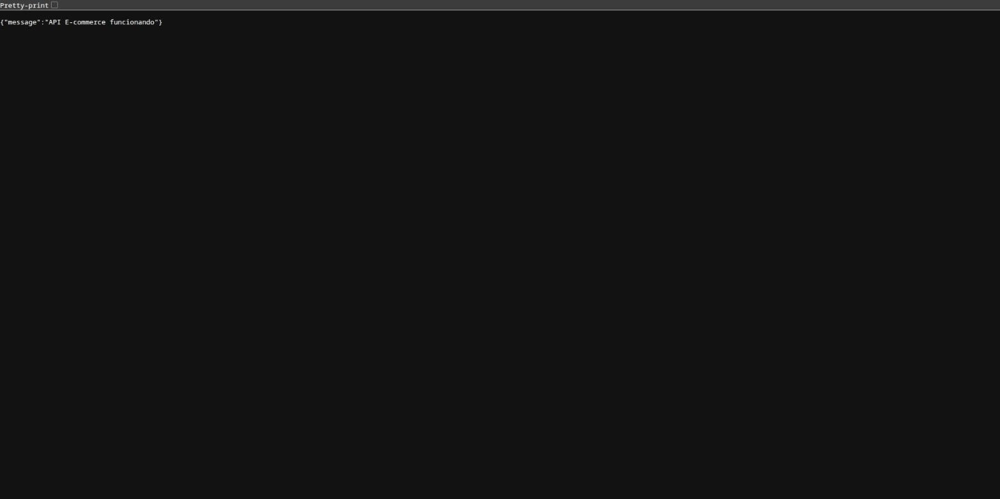
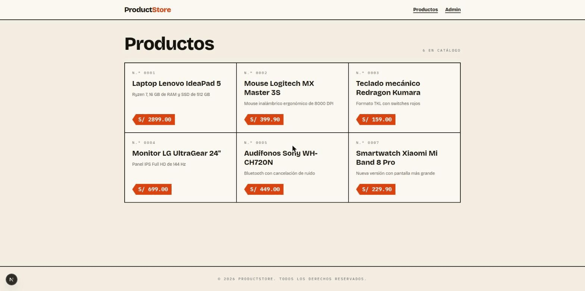
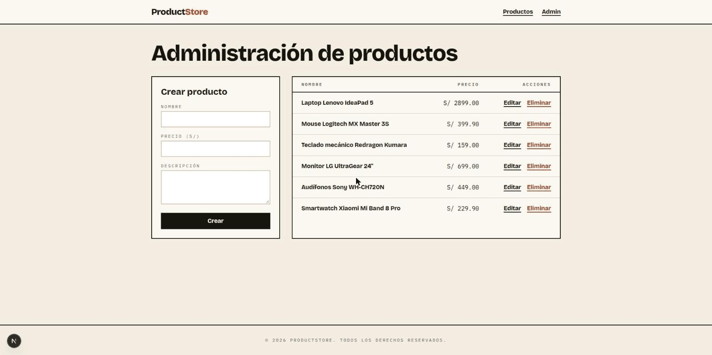

# Semana 15: Conexión backend y frontend (Mini Marketplace)

Laboratorio 15 de Desarrollo de Aplicaciones Web Avanzado (DAWA), Tecsup.

| Carpeta | Contenido |
|---|---|
| [`backend-marketplace`](backend-marketplace/) | API REST con Express 5, Sequelize y MySQL |
| [`frontend-marketplace`](frontend-marketplace/) | Next.js 16 (App Router), TypeScript y Tailwind CSS 4 |

Se usa **pnpm** en lugar de `npm`/`npx`.

## Estado

| Parte de la guía | Estado |
|---|---|
| 1. Base de datos | MariaDB local. Base en la nube pendiente |
| 2. Backend | Hecho y probado |
| 3. Frontend | Hecho y probado |
| Tarea: usuarios y roles, categorías y filtro | Pendiente |
| Tarea: CORS restringido | Hecho en local; falta el dominio de Vercel |
| Tarea: despliegue en Render y Vercel | Pendiente |

## Paso 1. Base de datos

La guía crea un MySQL en Railway. En este laboratorio se trabaja con **MariaDB** en el puerto 3307. Es un motor distinto, derivado de MySQL y compatible para lo que usa este proyecto: Sequelize se conecta con `dialect: 'mysql'` y el controlador `mysql2`.

```bash
# Una sola vez: crear el directorio de datos (sin root)
mkdir -p ~/.local/share/dawa-s15-db
mariadb-install-db --no-defaults --datadir=$HOME/.local/share/dawa-s15-db/data --auth-root-authentication-method=normal

# Cada sesión: arrancar el servidor (dejar la terminal abierta)
D=$HOME/.local/share/dawa-s15-db
mariadbd --no-defaults --datadir=$D/data --socket=$D/mysql.sock --port=3307 --bind-address=127.0.0.1
```

En otra terminal, una sola vez (usar la misma clave en el `.env`):

```bash
mariadb --no-defaults -S ~/.local/share/dawa-s15-db/mysql.sock -u root
```

```sql
CREATE DATABASE marketplace CHARACTER SET utf8mb4;
CREATE USER 'marketplace'@'127.0.0.1' IDENTIFIED BY 'cambia_esta_clave';
GRANT ALL ON marketplace.* TO 'marketplace'@'127.0.0.1';
```

## Paso 2. Backend

### 2.1 Dependencias

```bash
cd semana15/backend-marketplace
pnpm add express@^5.1.0 cors@^2.8.5 dotenv@^17.2.3 mysql2@^3.15.3 sequelize@^6.37.7
pnpm add -D nodemon@^3.1.14
```

Esos comandos ya quedaron registrados en `package.json`; en un clon nuevo basta `pnpm install`.

### 2.2 Estructura

```
src/
├── config/database.js                 conexión Sequelize
├── config/cors.js                     orígenes autorizados
├── models/Product.js                  modelo de la tabla products
├── controllers/product.controller.js  operaciones CRUD y validaciones
├── routes/products.js                 rutas de /api/products
├── app.js                             middlewares (CORS, JSON), rutas y 404
└── server.js                          conecta, sincroniza modelos y escucha
database/seed.sql                      datos de prueba
```

- `database.js` lee las credenciales del `.env`, que no se versiona.
- `sequelize.sync({ alter: true })` crea y ajusta las tablas según los modelos.
- El controlador responde siempre `{ success, message, data }`, con 400 si faltan datos o el precio no es mayor a 0 y 404 si el producto no existe.

Cambios frente a la guía: `engines` es `>=18.18` (la guía fija `18.x` y aquí se usa Node 24) y se añadió `database/seed.sql`, porque el script que menciona la guía no venía con el documento.

### 2.3 Ejecución y datos de prueba

```bash
cp .env.example .env     # completar DB_PASSWORD
pnpm dev                 # http://localhost:3001
mariadb --no-defaults -S ~/.local/share/dawa-s15-db/mysql.sock -u root marketplace < database/seed.sql
```

El script se ejecuta después del primer arranque, cuando la tabla ya existe.

### 2.4 Evidencias de los endpoints (Google Chrome)

Las capturas de `POST`, `PUT` y `DELETE` se tomaron antes de restringir CORS (ver 2.5).

Los `GET` se abren directamente en la barra de direcciones. `POST`, `PUT`, `DELETE` y el 404 se enviaron con `fetch` desde la misma pestaña, mostrando en pantalla la petición y la respuesta.



| Prueba | Resultado | Captura |
|---|---|---|
| `GET /` | API funcionando | [ver](capturas/01-api-raiz.jpg) |
| `GET /api/products` | 200, lista | [ver](capturas/02-get-products.jpg) |
| `GET /api/products/5` | 200, un producto | [ver](capturas/03-get-product-id.jpg) |
| `POST /api/products` | 201, creado (id 7) | [ver](capturas/04-post-product.jpg) |
| `PUT /api/products/7` | 200, actualizado | [ver](capturas/05-put-product.jpg) |
| `DELETE /api/products/6` | 200, eliminado | [ver](capturas/06-delete-product.jpg) |
| `GET /api/products/6` | 404, ya no existe | [ver](capturas/07-get-404.jpg) |

### 2.5 CORS restringido

La guía usa `cors()`, que acepta cualquier origen. Aquí solo se autorizan los dominios de la variable `CORS_ORIGINS` (`src/config/cors.js`):

| Petición | Respuesta |
|---|---|
| Desde un origen autorizado | Se atiende, con `Access-Control-Allow-Origin` para ese origen |
| Desde cualquier otro origen | 403 `Origen no permitido por CORS` |
| Sin cabecera `Origin` (servidor de Next.js, curl, barra de direcciones) | Se atiende: CORS no la regula |

- En desarrollo, si falta la variable, solo se autoriza `http://localhost:3000`.
- En producción (`NODE_ENV=production`), si falta la variable no se autoriza ningún origen.
- Al desplegar, `CORS_ORIGINS` debe ser la URL exacta del frontend, por ejemplo `https://mi-proyecto.vercel.app`.

CORS limita lo que otras páginas web pueden hacer desde el navegador, pero no reemplaza la autenticación: las rutas de escritura se protegerán por rol en la tarea.

Pruebas en Google Chrome: `/admin` en `http://localhost:3000` carga los productos, y las peticiones lanzadas desde `http://127.0.0.1:3000` (un origen distinto) quedan bloqueadas.

| Origen | Captura |
|---|---|
| Autorizado | [ver](capturas/17-cors-permitido.jpg) |
| No autorizado | [ver](capturas/18-cors-bloqueado.jpg) |


## Paso 3. Frontend

### 3.1 Creación del proyecto

```bash
cd semana15
pnpm dlx create-next-app@16.4.6 frontend-marketplace --ts --eslint --tailwind --src-dir \
  --app --turbopack --no-react-compiler --import-alias '@/*' --use-pnpm --disable-git --yes
```

La plantilla activa `cacheComponents` y `partialPrefetching`; se quitaron de `next.config.ts` para que `cache: 'no-store'` funcione como describe la guía.

### 3.2 Estructura

```
src/
├── types/product.ts          tipos Product y ApiResponse
├── lib/api.ts                URL de la API y formato de precios
├── components/               Navbar y Footer
├── styles/                   tokens, base y componentes
└── app/
    ├── layout.tsx            fuentes, Navbar y Footer
    ├── page.tsx              catálogo (componente de servidor)
    ├── products/[id]/        detalle del producto
    ├── admin/page.tsx        CRUD (componente de cliente)
    └── not-found.tsx         página 404
```

- El catálogo y el detalle consultan la API en el servidor con `cache: 'no-store'`, así siempre muestran datos actuales.
- `params` es una promesa en Next.js 16, por eso se usa `await params`.
- La API entrega `precio` como texto (tipo `DECIMAL`); `formatPrice` lo convierte.
- En `/admin`, eliminar pide un segundo clic en la misma fila en vez de `confirm()`, y los errores de la API se muestran en pantalla.
- Diseño propio tipo almacén: papel, tinta, una señal naranja, etiquetas de precio y las fuentes Bricolage Grotesque e IBM Plex Mono.

### 3.3 Ejecución

```bash
cd semana15/frontend-marketplace
cp .env.example .env.local
pnpm install
pnpm dev                 # http://localhost:3000
pnpm lint && pnpm build  # comprobaciones
```

Si `pnpm build` reporta estilos o fuentes que ya se corrigieron, borrar la caché con `rm -rf .next`.

### 3.4 Evidencias: páginas



| Página | Captura |
|---|---|
| `/` | [ver](capturas/08-home.jpg) |
| `/products/5` | [ver](capturas/09-detalle.jpg) |
| `/admin` | [ver](capturas/10-admin.jpg) |

### 3.5 Evidencias: CRUD desde la interfaz



| Paso | Captura |
|---|---|
| Formulario completo | [ver](capturas/11-admin-formulario.jpg) |
| Producto creado | [ver](capturas/12-admin-creado.jpg) |
| Editando el precio | [ver](capturas/13-admin-editando.jpg) |
| Precio actualizado | [ver](capturas/14-admin-actualizado.jpg) |
| Confirmación de borrado | [ver](capturas/15-admin-confirmar.jpg) |
| Producto eliminado | [ver](capturas/16-admin-eliminado.jpg) |
